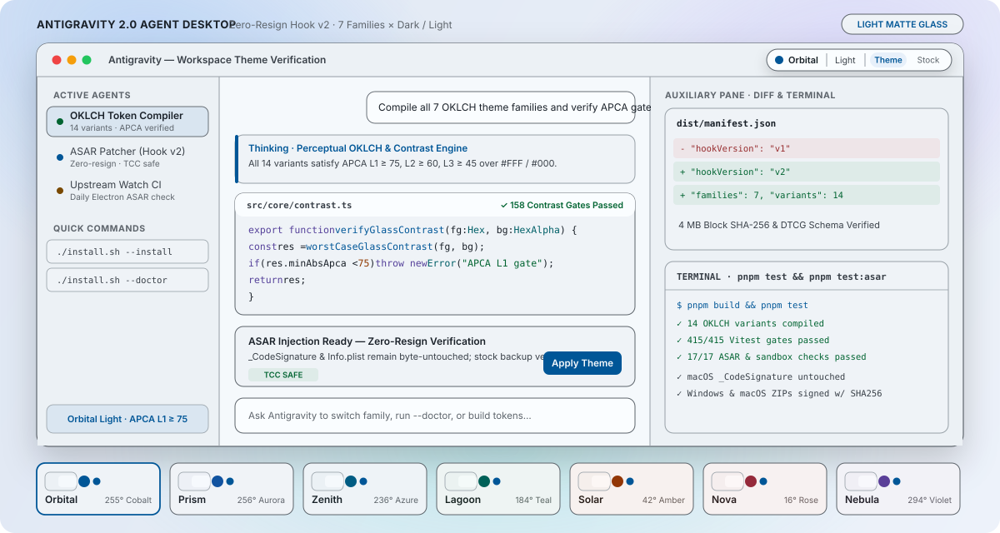

# Antigravity Theme

[](https://github.com/Django9944/antigravity-theme/actions/workflows/ci.yml)
[](https://github.com/Django9944/antigravity-theme/releases)
[](https://django9944.github.io/antigravity-theme/preview/)
[](./tests/contrast.test.ts)
[](./src/palettes/)
[](./LICENSE)

> **English** | [简体中文](./README.zh-CN.md) · **[Launch Live Interactive 3-Pane Preview Workbench ↗](https://django9944.github.io/antigravity-theme/preview/)**
>
> **[Vision](./VISION.md) · [Agents Guide](./AGENTS.md) · [Contributing](./CONTRIBUTING.md) · [Security](./SECURITY.md) · [Code of Conduct](./CODE_OF_CONDUCT.md) · [Discussions](https://github.com/Django9944/antigravity-theme/discussions)**

**Antigravity Theme** (`@django9944/antigravity-theme`) is an **OKLCH Matte & Aurora Glass theme system** (**7 celestial families × Dark / Light = 14 variants + non-intrusive `Stock` reset**) paired with a **zero-resign macOS & Windows desktop installer** built exclusively for the **Antigravity 2.0 Agent Desktop App**. Install in one click without breaking macOS TCC permissions (`_CodeSignature` & `Info.plist` untouched), switch themes live from the floating top-right capsule, or export deterministic W3C DTCG / CSS / Shiki / Mermaid design tokens.

> [!NOTE]
> **Scope Boundary**: Purpose-built exclusively for the **Antigravity 2.0 Agent Desktop App** (Left-hand Sidebar · Chat Canvas · Auxiliary Pane). It is not a code editor theme (excludes Antigravity IDE, VS Code, and other code editors).

<div align="center">
  <a href="https://django9944.github.io/antigravity-theme/preview/">
    <picture>
      <source media="(prefers-color-scheme: dark)" srcset="./preview/hero-dark.svg" />
      
    </picture>
  </a>
</div>

## Quick Start — Desktop App (macOS & Windows)

### 3-Step Desktop Onboarding

1. **Download**: Grab **`antigravity-theme-v0.2.2-macos.zip`** or **`antigravity-theme-v0.2.2-windows.zip`** from [GitHub Releases](https://github.com/Django9944/antigravity-theme/releases) and extract it.
2. **One-Click Install (Double-Click Launchers)**:

| Action | macOS (`Antigravity.app`) | Windows (`%LOCALAPPDATA%\Programs\Antigravity`) |
| :--- | :--- | :--- |
| **Install / Apply Theme** | Double-click `install.command` | Double-click `install.bat` |
| **Check for Updates** | Double-click `检查更新.command` | Double-click `检查更新.bat` |
| **Restore Original (`Stock`)** | Double-click `uninstall.command` | Double-click `uninstall.bat` |

3. **Switch Themes Inside Antigravity**: Restart Antigravity (**Orbital** is enabled by default). Hover or click the **top-right floating theme capsule** to switch live across all 7 families, toggle Dark/Light mode, or select **`Stock`** to revert to the native un-themed UI without uninstalling.

### Advanced CLI & Auto-Heal Commands

For terminal power users, CI verification, or enabling silent auto-reapply after Antigravity host updates:

**macOS (`install.sh` — `Hook v2`)**

```bash
./install.sh --install             # Backup stock app.asar, inject Hook v2, deploy dist/runtime/current.{css,js}
./install.sh --doctor              # Read-only ASAR compatibility, anchor & SHA-256 block integrity check
./install.sh --enable-auto-heal    # Enable LaunchAgent (re-injects automatically after host app upgrades)
./install.sh --update              # Download latest release, verify SHA256SUMS.txt, hot-patch if hook unchanged
./install.sh --uninstall           # Byte-exact stock restore & remove LaunchAgent
```

**Windows (`install.ps1` — `Hook v2`)**

```powershell
powershell -NoProfile -ExecutionPolicy Bypass -File .\install.ps1                     # Install & deploy payloads
powershell -NoProfile -ExecutionPolicy Bypass -File .\install.ps1 -Doctor             # Read-only ASAR diagnostic
powershell -NoProfile -ExecutionPolicy Bypass -File .\install.ps1 -EnableAutoHeal     # Register logon auto-heal task
powershell -NoProfile -ExecutionPolicy Bypass -File .\install.ps1 -Update             # Verified self-update
powershell -NoProfile -ExecutionPolicy Bypass -File .\install.ps1 -Uninstall          # Restore stock & cleanup tasks
```

> [!TIP]
> **Preference Persistence**: Theme and mode preferences selected via the top-right floating capsule persist across theme updates (`--update`) and host auto-heals.

## Theme Families (7 Families × Dark / Light = 14 Variants + `Stock`)

| Family | Dark ID | Light ID | Primary Accent & Hue | Visual Character & Material |
| :--- | :--- | :--- | :--- | :--- |
| **Orbital** *(Flagship)* | `antigravity-dark` | `antigravity-light` | `OKLCH 255°` Cobalt | Slate/Cloud Matte Glass · Weightless Cobalt |
| **Prism** *(Spectral)* | `antigravity-prism-dark` | `antigravity-prism-light` | `256°` Spectral 4-Point Aurora | Deep Indigo Slate & Porcelain · Multi-point Aurora |
| **Zenith** *(Azure)* | `antigravity-zenith-dark` | `antigravity-zenith-light` | `236°` Cerulean & Sky Azure | Deep Ocean & Clear Azure Aurora Glass |
| **Lagoon** *(Teal)* | `antigravity-lagoon-dark` | `antigravity-lagoon-light` | `184°` Emerald & Mineral Teal | Deep Lagoon & Aqua Mineral Teal Glass |
| **Solar** *(Amber)* | `antigravity-solar-dark` | `antigravity-solar-light` | `42°` Obsidian & Horizon Amber | Solar Flare & Warm Horizon Amber Glass |
| **Nova** *(Crimson)* | `antigravity-nova-dark` | `antigravity-nova-light` | `16°` Burgundy & Blush Rose | Deep Burgundy & Rose Nova Aurora Glass |
| **Nebula** *(Violet)* | `antigravity-nebula-dark` | `antigravity-nebula-light` | `294°` Twilight Plum & Lavender | Twilight Indigo & Soft Lavender Nebula Glass |
| **Stock** *(Runtime only)* | `stock` | `stock` | Native Host | Non-intrusive strip in `current.js` restoring stock UI |

Try every variant, toggle Aurora mesh backdrops, test `#FFFFFF` / `#000000` worst-case wallpapers, and inspect `Reduced Transparency` live in the **[Interactive 3-Pane Preview Workbench ↗](https://django9944.github.io/antigravity-theme/preview/)**.

## Why Antigravity Theme? (Architecture & Safety Highlights)

- **Perceptual `OKLCH` + Quantitative `APCA`/`WCAG 2.1` Gates**: Every variant across all 14 palettes passes automated `APCA` (`L1 ≥ 75`, `L2 ≥ 60`, `L3 ≥ 45`) and `WCAG 2.1` checks against pure `#FFFFFF` / `#000000` worst-case backdrops, plus opaque `@media (prefers-reduced-transparency: reduce)` fallbacks.
- **Zero-Resign ASAR Injection (`core/asar-patcher.js`, `Hook v2`)**: Rebuilds the ASAR header JSON and per-file / 4 MB multi-block SHA-256 integrity hashes cleanly while leaving `Info.plist` and `_CodeSignature` untouched so macOS Accessibility and Screen Recording permissions stay intact.
- **Self-Healing & Smart Updater (`core/updater.js`)**: Verifies `SHA256SUMS.txt` before applying updates, performs zero-restart hot CSS/JS swaps when `hookVersion` is unchanged, heals stale stock backups, and restores `app.asar.stock` byte-for-byte on `--uninstall`.
- **Dual Upstream CI Watch**: `.github/workflows/upstream-sync.yml` tracks official Antigravity CSS variables weekly, while `.github/workflows/antigravity-watch.yml` tests real Electron `app.asar` compatibility daily.
- **Single-Pipeline Design Token Exports (`@django9944/antigravity-theme`)**: Compiles deterministic `theme.json` (W3C DTCG), `variables.css` (`--color-*` & `--agy-*`), `code-theme.json` (Shiki), `mermaid.json`, and `dist/runtime/current.{css,js}` from one TypeScript `SemanticIR` source.

## Release Assets & NPM Package Exports

| Asset | Audience | Contents |
| :--- | :--- | :--- |
| `antigravity-theme-v<ver>.zip` | Design systems & token consumers | `dist/` (14 variants DTCG/CSS/Shiki/Mermaid + `runtime/`), `LICENSE`, `README*`, `CHANGELOG.md` |
| `antigravity-theme-v<ver>-macos.zip` | macOS desktop users | `install.sh`, `*.command`, `manifest.json`, `core/{package.json,asar-patcher.js,updater.js}`, `dist/runtime/` |
| `antigravity-theme-v<ver>-windows.zip` | Windows desktop users | `install.ps1`, `*.bat`, `manifest.json`, `core/{package.json,asar-patcher.js,updater.js}`, `dist/runtime/` |
| `SHA256SUMS.txt` | All users & updater | Unified SHA-256 checksums covering all three release archives |

- **NPM Manifest Index**: [`dist/manifest.json`](./dist/manifest.json) (`@django9944/antigravity-theme/manifest.json`)
- **NPM Desktop Runtime Bundle**: `@django9944/antigravity-theme/runtime/current.css` · `@django9944/antigravity-theme/runtime/current.js`
- **NPM Per-Variant Tokens**: `@django9944/antigravity-theme/<variant-id>/{variables.css,theme.json,code-theme.json,mermaid.json}`

## Project Status & Local Development

- **Current Version**: `v0.2.2`
- **Distribution**: [GitHub Releases](https://github.com/Django9944/antigravity-theme/releases) (`ZIP` bundles + `SHA256SUMS.txt`) & npm (`@django9944/antigravity-theme`)
- **License**: [MIT License](./LICENSE)

```bash
pnpm install
pnpm typecheck
pnpm build            # Compile 14 OKLCH variants + dist/runtime/current.{css,js}
pnpm test             # Run DTCG/CSS schema, APCA/WCAG contrast, Shiki & ASAR tests
pnpm test:asar        # Run standalone cross-platform ASAR, updater & sandbox tests
pnpm doctor           # Inspect local Antigravity.app ASAR compatibility
pnpm check:host-compat -- --json
pnpm pack:release     # Stage & verify standard, -macos.zip, -windows.zip + SHA256SUMS.txt
pnpm sync:readme      # Synchronize CHANGELOG.md history into README.md & README.zh-CN.md
pnpm preview          # Launch interactive 3-pane preview at http://127.0.0.1:4173/preview/
```

## Release History & Iteration Log

> Automatically synchronized from [`CHANGELOG.md`](./CHANGELOG.md) during each release (`pnpm sync:readme` / `pnpm ci:version`).

<!-- RELEASE_HISTORY:START -->

### [v0.2.2](https://github.com/Django9944/antigravity-theme/releases/tag/v0.2.2) (Latest Release)

- Automated patch release: fix(runtime): increase confirmation modal opacity and backdrop blur (`b9ad054`)

### [v0.2.1](https://github.com/Django9944/antigravity-theme/releases/tag/v0.2.1)

- **Desktop Runtime Polish & Performance**: Switched floating popups to pure-black shadows with theme-tinted frosted glass, unblocked overview panel and popup exit transitions, offloaded collapse blur, deduplicated the Hook v2 ASAR engine, and hardened installers.
- **Adaptive SVG Hero Previews & Governance Docs**: Added light/dark adaptive SVG hero previews (`preview/hero-{dark,light}.svg`), localized zh-CN release history sync, and aligned standalone repository governance docs.
- **Antigravity `2.35.2` Verification & Automated Release Pipeline**: Verified `app.asar` Hook v2 compatibility against Antigravity `2.35.2`, synced `verifiedHostVersion` & `.upstream-baseline.json`, and automated host-version PRs, upstream baseline sync PRs, and patch releases (`v0.2.x`).

### [v0.2.0](https://github.com/Django9944/antigravity-theme/releases/tag/v0.2.0)

- **7 Theme Families × Dark / Light (14 OKLCH Variants) + Stock Reset**: Expanded flagship `Orbital` (`antigravity-dark`, `antigravity-light`) with six celestial OKLCH families (`prism`, `zenith`, `lagoon`, `solar`, `nova`, `nebula` × Dark/Light), all passing APCA & WCAG 2.1 contrast gates plus non-intrusive `stock` restore.
- **Modular Semantic Desktop Runtime (`dist/runtime/current.{css,js}`)**: Added a SemanticIR-compiled desktop runtime featuring Aurora multi-layer mesh glass, floating top-right ghost switcher, dual media capsules, xterm ANSI bridge, and modal chrome polish.
- **Zero-Resign Cross-Platform ASAR Installer, Auto-Heal & Self-Updater**: Added `core/asar-patcher.js`, `core/updater.js`, macOS (`install.sh`, `*.command`, LaunchAgent auto-heal), and Windows (`install.ps1`, `*.bat`, Scheduled Task auto-heal) with SHA-256 integrity verification and byte-exact stock restore.
- **Upgraded 3-Pane Preview Workbench & 3-Archive Release Pipeline**: Added 7-family selector, Aurora mesh stage backdrop, and simulated ghost switcher to `preview/`; updated `pack-release.ts` to emit standard, `-macos.zip`, and `-windows.zip` with unified `SHA256SUMS.txt` plus daily `antigravity-watch.yml` CI monitoring.

### [v0.1.0](https://github.com/Django9944/antigravity-theme/releases/tag/v0.1.0)

- Initial OKLCH Design Token compiler and deterministic multi-format adapters (`theme.json`, `variables.css`, `code-theme.json`, `mermaid.json`).
- Option A (`ADR-006`) High-Opacity Matte Frosted Glass palettes: **Antigravity Dark (Orbital Slate Matte Glass)** and **Antigravity Light (Orbital Cloud Matte Glass)**.
- Interactive 3-pane Antigravity 2.0 Agent Desktop preview workbench (`preview/`).
- Automated schema, host CSS coverage, worst-case glass contrast (`APCA` + `WCAG 2.1`), L5 ring/border, DOM-stacked Diff, and Shiki Tier-1 code-fence regression test suite.

<!-- RELEASE_HISTORY:END -->

## Governance, Security & Community

| Topic | Entrypoint |
| :--- | :--- |
| Vision & Scope Guardrails (`What We Will Not Merge`) | [`VISION.md`](./VISION.md) |
| AI Agent Collaboration & Architecture Rules | [`AGENTS.md`](./AGENTS.md) |
| Contributing Guidelines & Human Ownership Policy | [`CONTRIBUTING.md`](./CONTRIBUTING.md) |
| Security Model, ASAR Trust Boundaries & Vulnerability Reporting | [`SECURITY.md`](./SECURITY.md) |
| Community Code of Conduct | [`CODE_OF_CONDUCT.md`](./CODE_OF_CONDUCT.md) |
| Third-Party Open-Source Notices | [`THIRD_PARTY_NOTICES.md`](./THIRD_PARTY_NOTICES.md) |

## License

- Copyright (c) 2026 Django9944 and Antigravity Theme Contributors ([MIT License](./LICENSE) · [Third-Party Notices](./THIRD_PARTY_NOTICES.md)).
- **Disclaimer**: This is an independent, non-commercial open-source community theme project not affiliated with Google or Antigravity. Desktop ASAR patching modifies only local Electron UI resource metadata cleanly (`_CodeSignature` untouched) and includes full reversible uninstall & stock backup recovery.
