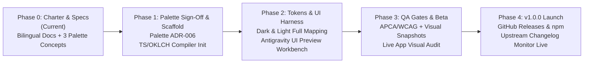

# 01 Project Charter

> [简体中文](../zh-CN/01-project-charter.md) | **English** | [Back to Docs Index](../README.md)

| Metadata | Details |
| :--- | :--- |
| **Project Name** | Antigravity Theme (`antigravity-theme`) |
| **Document Version** | v1.0.0-draft |
| **Date** | 2026-11-21 |
| **License** | MIT License |
| **Target Software** | Antigravity 2.0 Agent Desktop App Only (Excludes all code editors) |
| **Distribution Channels** | GitHub Releases (Versioned Theme Pack: JSON + CSS Variables) & npm (`@django9944/antigravity-theme`) |

---

## 1. Background & Motivation

### 1.1 Industry Pain Points: Agent Workbenches Lack Dedicated Visual Theme Systems

As **Antigravity 2.0 (the standalone Agent Desktop App)** becomes the daily orchestration hub for developers and knowledge workers, the primary interaction surface has moved from a traditional code editor to a **concurrent multi-agent workbench**:

1. **Fundamentally Different Information Density & State Hierarchy**: Users continuously scan across the **Left-hand Sidebar** (Conversations, Projects, Scheduled Tasks, Skills & Customizations, Settings), the **Chat Canvas** (user prompts, agent prose, collapsed Thinking traces, tool execution cards, permission approval prompts, `/` slash commands, `@` mentions), and the **Auxiliary Pane** (Subagents, Background Tasks, Artifacts, Files Changed Diffs, Terminals, Browser Pane).
2. **Long-Form Rich Media & Artifact Fatigue**: Core deliverables arrive as rich **Artifacts** (multi-section Markdown reports, 5-level GitHub Alerts, Mermaid diagrams, KaTeX math, Carousels) and **Files Changed Diffs**. Built-in generic light/dark modes leave significant room for improved reading ergonomics, calmer surface depth, and unified diagram/diff color harmony.
3. **Limited Built-In Appearance Options & No Standardized Community Theme Pack**: Antigravity 2.0 currently offers only a handful of built-in themes under `Settings > Appearance` (e.g., Light, Dark, Auto, Nord). The community lacks an open-source appearance configuration and theme package grounded in perceptual color science (`OKLCH`) and automated accessibility gates (`APCA` + `WCAG 2.1`).
4. **Host-to-Embedded UI Visual Drift**: Antigravity 2.0 passes theme variables (`--color-background-*`, `--color-text-*`, `--color-border-*`, `--color-ring-*`) to embedded HTML panels and MCP Apps. Without a coherent three-tier Design Token architecture, the host shell, Artifacts, and embedded panels drift in warmth and contrast.

### 1.2 Project Vision

Build an **open-source, engineering-driven flagship appearance configuration and theme package exclusively for the Antigravity 2.0 Agent Desktop App**:

- Grounded in **perceptual color science (`OKLCH`)** and dual accessibility baselines (`APCA` + `WCAG 2.1`);
- Purpose-built around **multi-agent, multi-pane visual grammar**;
- Delivered as a clean, standards-based, zero-hack **Theme Pack (JSON configuration schema + CSS Custom Properties + embedded code-fence highlight tables)** backed by automated visual regression and upstream changelog monitoring.

---

## 2. Positioning, Goals & Non-Goals

### 2.1 Core Positioning

- **Product Form**: A standardized appearance configuration and theme package for Antigravity 2.0 consisting of:
  1. Structured Theme Manifest (`theme.json` aligned with W3C Design Tokens & Antigravity Appearance semantics);
  2. Complete CSS Custom Properties stylesheet (`variables.css` covering Antigravity's `--color-*` host protocol and all three desktop zones);
  3. Embedded code-block syntax highlight palette (for fenced code blocks inside Chat Canvas and Artifacts).
- **Target Audience**: Daily users and open-source contributors orchestrating agents, automations, research, and engineering reviews inside Antigravity 2.0.
- **Community Model**: Open-source under **MIT License** with 1:1 mirrored English and Simplified Chinese documentation.

### 2.2 v1.0 Goals

1. **Core Dual Variants**: Ship `Antigravity Dark` and `Antigravity Light` in v1.0 while structuring the token schema for seamless future High-Contrast and Soft-Dim variants.
2. **Complete Antigravity 2.0 Surface Coverage**: Model 100% of the Left-hand Sidebar, Chat Canvas, all 6 Auxiliary Pane tabs (Subagents, Background Tasks, Artifacts, Files Changed, Terminals, Browser Pane), and the host CSS variable bridge.
3. **Single Source of Truth (SSOT)**: Build a TypeScript + `OKLCH` Design Token compiler that deterministically outputs all JSON, CSS, and code-fence highlight artifacts—never hand-editing compiled outputs.
4. **Verifiable Visual Quality**: Enforce automated `APCA` + `WCAG 2.1` contrast unit tests across prose, badges, Thinking/Tool cards, Artifact Alerts, Diff overlays, and 16-color terminal logs, paired with UI harness visual snapshot regression.
5. **Safe Delivery & Maintenance Automation**: Respect official configuration boundaries (zero binary tampering), with Changesets-driven releases (GitHub Releases + npm) and scheduled monitoring of Antigravity App release notes.

### 2.3 Explicit Non-Goals (v1.0)

| Non-Goal | Rationale | Future Placement |
| :--- | :--- | :--- |
| **Supporting Any Code Editor (Antigravity IDE, VS Code, Cursor, JetBrains, Neovim)** | This project aligns strictly with **Antigravity Agent (Antigravity 2.0 Desktop App)**—not a code editor color theme. No `.vsix` bundles, no Open VSX or VS Code Marketplace publishing. | Permanently out of scope |
| **Binary Patching, Electron Injection, or App-Signature Tampering** | Violates security/integrity boundaries and breaks on every app auto-update; we strictly target sanctioned configuration paths and official/upcoming custom theme import specs. | Permanently out of scope |
| **Custom Icon Packs / Brand Redesigns** | Iconography requires an independent pipeline; v1.0 focuses strictly on color architecture, contrast, and agent UI hierarchy. | Evaluate in v2.0 |
| **Launching v1.0 with 4+ Variants** | Perfecting Dark + Light yields higher craft than diluting focus early. | High Contrast / Soft Dim planned for v1.x |

---

## 3. Competitive & Baseline Analysis

| Dimension | Antigravity Built-In (Light/Dark/Nord) | Claude / ChatGPT Desktop Defaults | Generic CSS Theme Kits (Catppuccin / Radix) | **Antigravity Theme (Ours)** |
| :--- | :--- | :--- | :--- | :--- |
| **Core Strength** | Zero setup, native defaults | Minimalist warm prose reading comfort | Mature palettes, large communities | **Purpose-built for Antigravity 2.0 multi-pane agent workflows + OKLCH engineering** |
| **Multi-Agent State Hierarchy** | Basic cues; deep tool chains & subagents feel visually flat | Single-chat focus; no Subagents / Tasks / Files Changed side panes | No native Agent semantics (Thinking / Tool / Approval / Artifact Alerts) | **Explicitly models Sidebar + Chat + all 6 Auxiliary Pane states** |
| **Artifacts & Long-Form Ergonomics** | Generic styling; diagrams & alerts vary across modes | Comfortable prose, lacks complex Artifact + Diff co-views | Requires extensive manual remapping | **Harmonizes Markdown, 5-tier Alerts, Mermaid, KaTeX, and Diff washes** |
| **Engineering & Maintenance** | Bundled black-box updates | Closed, non-customizable | Static palettes without Agent UI visual regression | **TS + OKLCH + APCA/WCAG gates + UI harness snapshots + App changelog monitor** |

**Key Differentiators**:
1. **Agent-First Semantic Grammar**: Treats collapsed thinking traces, 4-state tool cards (`Running` / `Done` / `Error` / `Needs Approval`), concurrent Subagents, rich Artifacts, and Files Changed Diffs as first-class visual primitives.
2. **Scientific Ergonomics**: `OKLCH` equalizes perceptual lightness across hues, backed by quantitative `APCA + WCAG 2.1` verification.
3. **Future-Proof Official Alignment**: Compiles cleanly to W3C Design Token JSON and Antigravity's documented `--color-*` host CSS variables, ready to plug into official custom theme import APIs without re-architecting.

---

## 4. Milestone Roadmap

| Phase | Key Deliverables | Exit Criteria |
| :--- | :--- | :--- |
| **Phase 0: Initiation & Specs** | Mirrored `01`–`07` bilingual docs, 3 candidate palette proposals | All specifications approved; Agent-only scope & delivery model locked |
| **Phase 1: Palette & Scaffold** | Selected palette (`ADR-006`), repo skeleton, OKLCH compiler core | `pnpm build` outputs deterministic Theme Pack (JSON + CSS) passing schema checks |
| **Phase 2: Dual Variants & UI Harness** | Full `Antigravity Dark` & `Antigravity Light` tokens + Antigravity 2.0 UI simulation harness | Covers Left Sidebar, Chat Canvas, and all 6 Auxiliary Pane views |
| **Phase 3: QA Gates & Beta** | APCA/WCAG unit tests, Playwright/Shiki visual baselines, `v0.9.0-beta` Theme Pack | Zero contrast failures; 100% manual sign-off checklist passed |
| **Phase 4: v1.0.0 Launch** | Public GitHub Release bundle, npm `@django9944/antigravity-theme`, upstream monitor active | Automated release pipeline verified; documentation & preview gallery live |

---

## 5. Success Metrics (KPIs / OKRs)

### 5.1 Engineering & Quality Gates (Mandatory Before v1.0.0)

- **Contrast Compliance**: 100% of primary prose, Chat threads, and Artifact reading surfaces meet `APCA Lc >= 75` (hard floor `>= 60`) and `WCAG 2.1 AA` (`>= 4.5:1`).
- **Host Variable Coverage**: 100% coverage of Antigravity's `--color-background-*`, `--color-text-*`, `--color-border-*`, and `--color-ring-*` tokens plus all planned Agent component tokens.
- **Deterministic Compilation**: Byte-for-byte identical `dist/` artifacts (JSON + CSS) across OS and Node LTS environments.
- **Regression Pass Rate**: 100% passing contrast tests, JSON Schema validation, UI harness snapshots, and Shiki code-fence baselines.

### 5.2 Community & Adoption Metrics (6 Months Post-v1.0)

- **Adoption**: `>= 500` GitHub Stars and `>= 3,000` combined GitHub Release / npm downloads.
- **Ecosystem Alignment**: Reference community theme spec for Antigravity 2.0, adapting to official Appearance / theme schema updates within `<= 7 days`.
- **Responsiveness**: Issue First Response Time (FRT) `<= 72 hours`.

---

## 6. Risk Register & Mitigations

| Risk ID | Description | Likelihood | Impact | Mitigation Strategy |
| :--- | :--- | :---: | :---: | :--- |
| **R-01** | **Antigravity 2.0 official third-party custom theme import format is still evolving** | High | High | Use an "IR + Adapter" design: author canonical W3C DTCG JSON and official host CSS variables (`--color-*`). When Antigravity publishes or updates its custom theme import manifest, add a lightweight compiler adapter—never resort to binary patching. |
| **R-02** | **Rapid Antigravity App UI updates introduce new panels or state tokens** | High | Medium | Run a weekly GitHub Action inspecting `antigravity.google/docs/changelog.md` (`## Antigravity App`) and host CSS variable specs, shipping missing tokens within 7 days. |
| **R-03** | **OKLCH-to-sRGB gamut clipping shifts perceived contrast** | Medium | Medium | Use `culori` perceptual gamut mapping (preserve `L`/`H`, gently reduce `C`) and re-validate contrast on final compiled sRGB hex outputs. |
| **R-04** | **Light mode looks harsh or washed out during long Artifact reading** | Medium | High | Calibrate independent Light elevation steps and chroma ceilings, subjecting Markdown, 5-level Alerts, Mermaid, and Diffs to identical visual regression gates as Dark mode. |
| **R-05** | **Bilingual documentation drift over time** | Medium | Low | Enforce PR review checks and `docs-sync` tracking issues whenever architectural or process docs change. |

---

## 7. Stakeholders & Decision Model

- **Project Lead / Core Maintainers**: Own visual vision, final palette sign-off, release approval, and community governance.
- **Community Contributors**: Submit new variant RFCs, contrast fixes, UI harness scenarios, and bilingual docs updates.
- **End Users (Antigravity 2.0 Agent Users)**: Report real-world agent workflow visual ergonomics via GitHub Discussions and Issues.

> **Next Document**: [02 PRD & Requirements](./02-prd-requirements.md)
