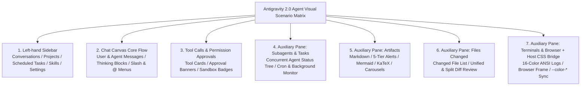

# 02 Product Requirements Document (PRD)

> [简体中文](../zh-CN/02-prd-requirements.md) | **English** | [Back to Docs Index](../README.md)

| Metadata | Details |
| :--- | :--- |
| **Related Charter** | [01 Project Charter](./01-project-charter.md) |
| **Target Software** | Antigravity 2.0 Agent Desktop App Only (Excludes code editors) |
| **Target Release** | `v1.0.0` (with architectural hooks for future variants) |
| **Requirement Status** | Draft — Pending Review |

---

## 1. Target User Personas

| Persona | Profile | Environment & Pain Points | Primary Needs |
| :--- | :--- | :--- | :--- |
| **P1: Multi-Agent Orchestration Engineer** | Runs concurrent Subagents, Background Tasks, and automations inside Antigravity 2.0 all day | Monitors Chat Canvas, Subagents, Tasks, and Terminals simultaneously; approval prompts and tool errors get buried in busy logs | Crisp operational status grammar (`Running` / `Waiting` / `Needs Approval` / `Done` / `Error`) that surfaces blockers instantly |
| **P2: Deep Researcher & Artifact Reviewer** | Reads and critiques long-form Agent Artifacts (reports, architecture plans, Mermaid graphs, KaTeX math) | Pure black/white backdrops strain eyes during 2,000-word reads; 5-tier Alerts and diagrams feel visually mismatched | Editorial-grade reading comfort in both Dark and Light with harmonious typography and diagram contrast |
| **P3: Code & Delivery Auditor** | Reviews agent-authored changes inside the **Files Changed** pane and inspects **Terminals** logs | Over-saturated red/green diffs fatigue eyes; ANSI terminal outputs lose contrast in light or dark panes | Calm translucent diff washes, legible embedded syntax highlighting, and strictly verified 16-color ANSI output |
| **P4: Visual-Comfort / Accessibility User** | Mild astigmatism, halation sensitivity, or bright-office display glare | Default dark themes wash out under daylight; harsh light themes induce glare | Guaranteed APCA + WCAG contrast floors, CVD-safe cues, and future High-Contrast variants |

---

## 2. Core Usage Scenarios (Antigravity 2.0 Agent UI Breakdown)

Anchored strictly on **Antigravity 2.0's** three-pane architecture and host variable bridge, the theme must establish clear visual differentiation across **7 core surfaces**:

### Scenario 1: Left-hand Sidebar (Navigation & Global Controls)
- **Covered Elements**: New Conversation CTA, conversation list (active, hover, unread/running indicators), Projects switcher, Scheduled Tasks badges (cron/timer), Skills & Customizations browser, Settings panels (Model Selection, Tool Execution Policy, Sandbox, Appearance).
- **Visual Goal**: Calm recessed navigation shell (Elevation 0) that highlights active/running sessions without competing with the central Chat Canvas.

### Scenario 2: Chat Canvas (Conversation Flow, Thinking & Composer)
- **Covered Elements**: User message cards/blocks, Agent Markdown prose, collapsible **Thinking / Reasoning traces**, `/` Slash Commands popover, `@` Mentions picker (files, conversations, terminals, rules, MCP tools), Media Upload attachments, and bottom multi-line composer with Send/Stop actions.
- **Visual Goal**:
  - **Thinking vs Final Answer**: Render thinking traces in a subtly recessed container with a quiet vertical accent rule—clearly subordinate to final answers while remaining comfortably legible when expanded.
  - Give `/` and `@` floating menus crisp elevation (Elevation 3) and unmistakable keyboard focus highlights.

### Scenario 3: Tool Execution Cards & Permission Approvals
- **Covered Elements**: Collapsible tool execution cards (file ops, shell commands, web searches, MCP calls), 4-state status semantics (`Running`, `Done`, `Error`, `Awaiting Approval`), Approve / Reject / Allow action groups, and Sandbox badges.
- **Visual Goal**: Make **Awaiting Approval** and **Error** states immediately scannable across long multi-step tool trajectories so critical human-in-the-loop decisions are never missed.

### Scenario 4: Auxiliary Pane — Subagents & Background Tasks
- **Covered Elements**: Parallel subagent status cards (role, model badge, states: `working`, `waiting`, `stopped`, `killed`), scheduled/background task cards, streaming logs, and control actions.
- **Visual Goal**: Consistent operational color grammar (active = primary accent, waiting/idle = muted neutral, complete = semantic green, error/terminated = semantic red/amber) with zero visual clutter during sustained monitoring.

### Scenario 5: Auxiliary Pane — Artifacts (Rich Documents, Diagrams & Math)
- **Covered Elements**: Heading hierarchy (H1–H6), prose and links, all 5 GitHub Alert tiers (`[!NOTE]`, `[!TIP]`, `[!IMPORTANT]`, `[!WARNING]`, `[!CAUTION]`), Mermaid flowcharts/sequence/state diagrams, KaTeX math expressions, Carousels, tables, and embedded fenced code blocks.
- **Visual Goal**: Distinct left accent bars and restrained translucent tints for all 5 Alert tiers; legible Mermaid strokes/labels and KaTeX formulas in both Dark and Light modes.

### Scenario 6: Auxiliary Pane — Files Changed (Diff Auditing)
- **Covered Elements**: Changed file list (Added/Modified/Deleted/Renamed badges, `+N / -M` counters), line-level and word-level diff highlights, line gutters, and collapsed context dividers.
- **Visual Goal**: Low-chroma translucent green/red washes that preserve embedded syntax highlighting during extended multi-file agent reviews.

### Scenario 7: Auxiliary Pane — Terminals, Browser Pane & Host CSS Variable Bridge
- **Covered Elements**: Integrated terminal 16-color ANSI output, Browser Pane header/status chrome, and Antigravity's standard host CSS variables (`--color-background-*`, `--color-text-*`, `--color-border-*`, `--color-ring-*`, `--font-sans`) consumed by embedded HTML panels and MCP Apps.
- **Visual Goal**: Seamless visual continuity between the desktop shell, terminal logs, and embedded views with 100% ANSI contrast verification.

---

## 3. Theme Variant Matrix

| Display Name | Theme Mode | Target Release | Primary Use Case | Architectural Status |
| :--- | :--- | :---: | :--- | :--- |
| **Antigravity Dark** | `dark` | **v1.0.0** | Daily primary dark environment, extended low-light agent orchestration | v1.0 Core Deliverable |
| **Antigravity Light** | `light` | **v1.0.0** | Daylight offices, long-form Artifact reading, demos & screen sharing | v1.0 Core Deliverable |
| **Antigravity Dark High Contrast** | `hc-dark` | v1.1.0 | Accessibility high-contrast needs, glare-heavy monitors | Architecturally Reserved |
| **Antigravity Light High Contrast** | `hc-light` | v1.1.0 | Intense ambient light, lecture halls & projectors | Architecturally Reserved |
| **Antigravity Dim (Soft Dark)** | `dark` | v1.2.0 | Ultra-low-glare preference for sensitive eyes | Architecturally Reserved |

---

## 4. Functional Requirements

| ID | Module | Specification | Priority |
| :--- | :--- | :--- | :---: |
| **FR-01** | Standardized Theme Pack Manifest | Emit W3C DTCG-aligned `theme.json` capturing metadata, appearance mode, 3-pane surface tokens, agent state tokens, and embedded code-block palettes. | P0 |
| **FR-02** | Host CSS Variables Stylesheet | Emit `variables.css` mapping 100% of Antigravity's documented host variables (`--color-background-{primary,secondary,tertiary,inverse,disabled,info,danger,success,warning}`, `--color-text-*`, `--color-border-*`, `--color-ring-*`) plus extended Agent UI tokens (`--agy-*`). | P0 |
| **FR-03** | Three-Pane Agent & Frosted Glass Tokens | Complete token coverage for Left-hand Sidebar, Chat Canvas (Thinking, Tool Cards, Approvals, `/` & `@` Menus), and all 6 Auxiliary Pane views, including layered frosted-glass material tokens (opacity, blur radius, saturation, specular borders, and `prefers-reduced-transparency` opaque fallbacks). | P0 |
| **FR-04** | Rich Artifact Styling Spec | Complete styling tokens for Markdown typography, 5-tier Alerts, tables, Mermaid diagram themes, KaTeX expressions, and Carousel controls. | P0 |
| **FR-05** | Embedded Code-Fence & Diff Palette | Emit Shiki-compatible syntax highlight JSON for code blocks inside Chat Canvas, Artifacts, and Files Changed Diffs across all Tier-1 languages. | P0 |
| **FR-06** | Terminal ANSI 16-Color Palette | Complete background, foreground, selection, cursor, and 16 ANSI color tokens for the Auxiliary Pane terminal. | P0 |
| **FR-07** | Appearance Config & Official Import Spec | Provide clear `Settings > Appearance` alignment guides, config schemas, and an adapter blueprint for official custom theme import (zero binary patching). | P1 |
| **FR-08** | Interactive UI Simulation Harness | Ship a static web workbench mirroring Antigravity 2.0's 3-pane layout with instant Dark/Light switching and contrast inspection. | P1 |

---

## 5. Non-Functional Requirements

| ID | Dimension | Quantitative Target | Verification |
| :--- | :--- | :--- | :--- |
| **NFR-01** | **Zero-Tamper Compliance** | Pure static data artifacts (JSON + CSS); zero binary patching, Electron injection, or sandbox workarounds. | Code review + dist allowlist check |
| **NFR-02** | **Accessibility & Contrast** | Primary prose/Chat/Artifacts text meets `APCA Lc >= 75` (hard floor `>= 60`) and `WCAG 2.1 >= 4.5:1`; muted metadata & Thinking blocks meet `APCA Lc >= 45` and `WCAG >= 3.0:1`; CVD-safe status indicators. | Automated Vitest contrast suite |
| **NFR-03** | **Exclusive Software Scope** | Targets **Antigravity 2.0 Agent Desktop App** exclusively (macOS, Windows, Linux); zero code editor adaptation overhead. | PRD & PR review gate |
| **NFR-04** | **Deterministic Builds** | Identical source compiles to byte-for-byte identical `dist/` files (JSON + CSS) across OS and Node LTS versions. | CI clean build + `git diff --exit-code` |
| **NFR-05** | **Variant Extensibility** | Adding a new variant requires adding only 1 OKLCH palette module and registering it—zero mapper duplication. | Architecture review + multi-variant unit test |
| **NFR-06** | **Bilingual Documentation** | Core specs and governance docs remain mirrored 1:1 in English and Simplified Chinese. | PR Review Checklist |

---

## 6. Embedded Code-Fence Language Coverage (Tier-1)

Although this is not a code editor theme, fenced code blocks appear constantly in Agent replies, Artifacts, and Files Changed Diffs. v1.0 provides tuned highlighting and Shiki snapshot regression for these **Tier-1 languages**:

| Category | Tier-1 Code-Fence Languages | Key Features Verified |
| :--- | :--- | :--- |
| **Web / Full-Stack** | TypeScript / JavaScript (incl. JSX / TSX) | Type annotations, generics, async keywords, template interpolation, JSX tags |
| **AI / Data / Scripting** | Python | Decorators, type hints, f-strings, docstrings, `async`/`await` |
| **Cloud-Native / Backend** | Go / Rust / Java | Structs/traits/interfaces, lifetimes/macros, annotations, error handling |
| **Markup & Styles** | HTML / CSS | Tags, attributes, CSS custom properties (`--var`), selectors & values |
| **Config & Data** | JSON / YAML / TOML | Clear key vs string separation, booleans/numbers/null, comments |
| **Docs & Changes** | Markdown / Shell (Bash/Zsh) / Unified Diff | Nested headings/fences, env vars & pipes, diff hunks (`@@`/`+`/`-`) |

---

## 7. v1.0 Definition of Done (DoD)

1. **Dual Variants Verified**: Both `Antigravity Dark` and `Antigravity Light` pass 100% of automated gates (schema, 100% host CSS variable coverage, APCA/WCAG contrast matrix, deterministic build).
2. **UI Harness Baselines Frozen**: The 3-pane Antigravity 2.0 preview harness (covering all 7 scenarios + Tier-1 code fences) has frozen Dark & Light visual snapshots with human sign-off.
3. **Live App Alignment Audit**: Verified side-by-side against Antigravity 2.0 Desktop App layouts and `--color-*` host variable specs with zero illegible text, fused popovers, or broken Alert/Mermaid contrast.
4. **Release & Legal Readiness**: `LICENSE` (MIT), bilingual `README`s, `CHANGELOG.md`, Theme Pack bundle, and GitHub Release / npm packaging ready.

> **Next Document**: [03 Visual Design System & Palette Review](./03-visual-design-system.md)
