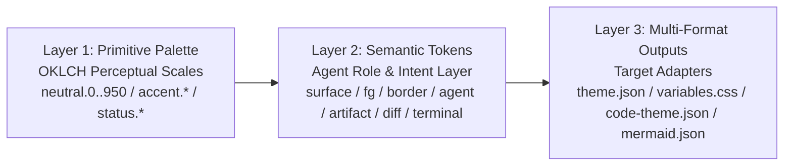

# 03 Visual Design System & Palette Review Framework

> [简体中文](../zh-CN/03-visual-design-system.md) | **English** | [Back to Docs Index](../README.md)

| Metadata | Details |
| :--- | :--- |
| **Related PRD** | [02 Product Requirements Document](./02-prd-requirements.md) |
| **Target Software** | Antigravity 2.0 Agent Desktop App |
| **Design Status** | **Approved**: Locked **Option A (Orbital Slate Dark + Orbital Cloud Light · High-Opacity Matte Frosted Glass)** — see `ADR-006` |
| **Color Space** | OKLCH (perceptually uniform) -> compiled to sRGB Hex / CSS Variables |
| **Accessibility Standard** | APCA (WCAG 3 candidate) + WCAG 2.1 (dual enforcement) |

---

## 1. Core Visual Philosophy

Designed specifically for a multi-agent desktop workbench, Antigravity Theme is governed by three principles—**Weightless 3-Pane Depth, Calm Orchestration, and Editorial Artifact Comfort**:

1. **Weightless 3-Pane Depth**:
   - Avoid heavy drop shadows or high-contrast divider lines. Separate the **Left-hand Sidebar**, **Chat Canvas**, **Auxiliary Pane**, and floating popovers (`/` menu, `@` picker, approval modals) via calibrated luminance elevation steps.
   - Avoid pure `#000000` and `#FFFFFF` large backdrops (outside High-Contrast variants) to eliminate halation during long reading and monitoring sessions.
2. **Calm Agent Orchestration**:
   - High operational density demands visual restraint. Keep ordinary messages, completed tool cards, and idle subagents in calm neutral tones; reserve high-salience chromatic accents for **Running, Needs Approval, Errors, high-priority Alerts, and Diffs**.
   - `Antigravity Light` is crafted independently—never an inverted dark mode—using stricter chroma caps for studio-paper reading clarity.
3. **Unified Host & Rich Media Harmony**:
   - The main desktop shell, Artifacts (Markdown, 5-tier Alerts, Mermaid, KaTeX), Files Changed Diffs, 16-color terminal logs, and exported host CSS variables (`--color-*`) all derive from a single OKLCH semantic root—preventing warm/cool clash across panes.

---

## 2. Color Science & Contrast Baselines (OKLCH + APCA + WCAG 2.1)

### 2.1 Why OKLCH Is Our Single Design Space

Legacy HSL/HSV suffers from severe perceptual brightness skew across hues. Authoring in **OKLCH (`L` perceptual lightness, `C` chroma, `H` hue angle)** gives us three structural benefits:

- **Equiluminant Status & Diagram Wheel**: 5-tier Artifact Alerts, tool status badges, Mermaid nodes, and embedded code-fence tokens share a balanced `L` band with uniform visual weight.
- **Predictable Dark/Light Pairing**: `Antigravity Dark` and `Antigravity Light` share the same hue skeleton `H` while systematically remapping lightness ramps `L` and chroma ceilings `C`.
- **Safe Perceptual Gamut Mapping**: Out-of-gamut coordinates map into sRGB by preserving `L` and `H` and smoothly pulling `C` inward—preventing unexpected contrast collapse.

### 2.2 Dual-Model Contrast Enforcement Baselines

Every compiled sRGB foreground/background pair—including alpha-composited cards and washes—must clear both APCA and WCAG 2.1 thresholds in build & CI gates:

| Visual Tier | Representative Antigravity 2.0 Elements | APCA Target (`\|Lc\|`) | APCA Hard Floor | WCAG 2.1 Minimum |
| :--- | :--- | :---: | :---: | :---: |
| **L1 Primary Content** | Chat prose, Artifact Markdown body, active sidebar title, Settings labels | `>= 80` (Light `>= 85`) | `>= 75` | `>= 7.0:1` (AAA target) / `4.5:1` min |
| **L2 Interactive & Semantic** | Links, `/` command items, tool names, embedded code tokens, Mermaid labels, KaTeX | `>= 70` | `>= 60` | `>= 4.5:1` (AA) |
| **L3 Muted & Reasoning** | **Thinking trace body**, timestamps, collapsed tool summaries, inactive sidebar rows | `50 – 65` | `>= 45` | `>= 3.0:1` |
| **L4 Status & Approvals** | Running / Done / Needs Approval / Warning / Error badges, 5-tier Alert titles | `>= 65` | `>= 58` | `>= 4.5:1` |
| **L5 Non-Text Chrome** | Pane dividers, card borders, focus rings (`--color-ring-*`), scrollbars | `>= 30` (focus `>= 45`) | `>= 20` (dividers) / `>= 35` (focus) | `>= 3.0:1` (focus rings & key icons) |

> **Color Vision Deficiency (CVD) Guardrails**:
> - Never distinguish tool states, Subagent states, Files Changed Diffs, or 5-tier Alerts by red/green hue alone; always pair hue with luminance deltas, icons, and text labels.
> - Audit the final palette under Deuteranopia, Protanopia, and Tritanopia simulations before Phase 2 freeze.

---

## 3. Three-Tier Design Token Architecture

To scale cleanly from Dark & Light to future High-Contrast and Soft-Dim variants with zero duplication:

### 3.1 Layer 1: Primitive Palette
- **Neutral Ramp**: 12 calibrated lightness stops (`bg-deep` -> `bg-canvas` -> `bg-surface` -> `bg-elevated` -> `bg-overlay` -> `border-subtle` -> `border-strong` -> `fg-muted` -> `fg-secondary` -> `fg-primary`).
- **Chromatic Wheel**: 8 core hues (Blue, Cyan, Violet, Green, Amber, Orange, Red, Magenta), each with `default`, `bright`, and `tint` (low-chroma surface fill) grades.

### 3.2 Layer 2: Semantic Tokens (Antigravity Agent Domain)
- `surface.*`: `sidebar`, `canvas`, `auxPane`, `card`, `elevated`, `input`, `hover`, `selected`.
- `fg.*`: `primary`, `secondary`, `muted`, `disabled`, `inverse`, `accent`, `link`.
- `border.*`: `subtle`, `default`, `strong`, `focusRing`.
- `agent.*`: `userBubbleBg`, `thinkingBg`, `thinkingBorder`, `thinkingFg`, `toolCardBg`, `approvalBg`, `approvalBorder`, `runningAccent`, `subagentWorking`, `subagentWaiting`.
- `artifact.*`: `alertNote`, `alertTip`, `alertImportant`, `alertWarning`, `alertCaution` (each with `bg`/`border`/`fg`), `blockquoteBorder`, `tableHeaderBg`, `codeBlockBg`, `mermaidNodeBg`, `mermaidEdge`.
- `diff.*`: `addedBg`, `addedWordBg`, `removedBg`, `removedWordBg`, `modifiedBadge`.
- `code.*`: 12 core syntax roles for embedded fenced code blocks.
- `terminal.ansi.*`: All 16 ANSI terminal slots.

### 3.3 Layer 3: Multi-Format Outputs
- Compiled deterministically into `theme.json`, `variables.css` (including all host `--color-*` variables), `code-theme.json`, and `mermaid.json` (detailed in [04 Technical Architecture](./04-technical-architecture.md)).

---

## 4. Antigravity 2.0 Three-Pane Elevation & High-Opacity Matte Glass Spec

**High-Opacity Matte Frosted Glass** is the signature material language of Antigravity Theme: instead of overly see-through glass that lets busy wallpaper patterns distract from reading, it pairs **high opacity (84%–97%), deep `backdrop-filter` blur (`24px–32px`), and directional `1px` specular rim highlights**—allowing only a whisper of ambient desktop warmth/coolness through sidebars and popovers while keeping central prose velvety and editorial-sharp.

### 4.1 Four-Tier High-Opacity Matte Glass Ramp

| Elevation Tier | Antigravity 2.0 Surface Regions | Dark Glass Params (Alpha / Blur / Saturate) | Light Glass Params (Alpha / Blur / Saturate) | Rim & Shadow Craft |
| :--- | :--- | :--- | :--- | :--- |
| **Elevation 0 (Recessed Matte Shell)** | Left-hand Sidebar, Auxiliary Pane header & shell | `L_canvas - 0.025`, `α = 0.84–0.88`, `blur(28px) saturate(130%)` | `L_canvas - 0.025`, `α = 0.86–0.90`, `blur(28px) saturate(135%)` | Dark: `1px rgba(255,255,255,0.08)`; Light: `1px rgba(255,255,255,0.70)` |
| **Elevation 1 (Primary Velvet Glass Canvas)** | Chat Canvas main backdrop, Artifacts sheet, Files Changed view | Anchor `L_canvas`, `α = 0.92–0.96`, `blur(24px) saturate(115%)` (near-opaque for zero distraction) | Anchor `L_canvas`, `α = 0.94–0.97`, `blur(24px) saturate(120%)` | Ultra-subtle hairline dividers preserving quiet spatial depth |
| **Elevation 2 (Matte Frosted Cards)** | User prompt card, Thinking trace card, Tool Call cards, Code fences, Subagent cards | `L_canvas + 0.030`, `α = 0.78–0.86` (layered over canvas) | `L_canvas - 0.018`, `α = 0.84–0.90` (satin alabaster glass) | Top `inset 0 1px 0` specular rim + diffused ambient shadow |
| **Elevation 3 (Weightless Floating Glass)** | `/` Slash menu, `@` Mentions picker, Approval modal, floating composer bar | `L_canvas + 0.055`, `α = 0.88–0.93`, `blur(32px) saturate(145%)` | Luminous matte white `α = 0.90–0.95`, `blur(32px) saturate(145%)` | Crisp specular rim + multi-layer soft elevation shadow |

### 4.2 Frosted Glass Accessibility & Performance Guardrails

1. **Worst-Case Wallpaper Contrast Envelope**: Thanks to high-opacity matte glass, compositing any surface over BOTH pure white (`#FFFFFF`) and pure black (`#000000`) wallpapers keeps primary text strictly at `APCA Lc >= 70` (`>= 78` on balanced backdrops).
2. **Mandatory Reduced-Transparency Fallback**: `variables.css` must include `@media (prefers-reduced-transparency: reduce)` raising all surface alphas to `1.0` and disabling `backdrop-filter` for accessibility users and low-power GPUs.
3. **5-Tier Alerts & Diff Washes**: Alerts use `10%–14%` translucent tints + `3px` solid left bar; Files Changed line diffs use `12%–18%` alpha and word-level emphasis `28%–36%`, keeping underlying code syntax at `APCA Lc >= 55`.

---

## 5. Candidate Palette Proposals (For Review)

Below are **3 distinct aesthetic directions**, each pre-calibrated to our OKLCH and APCA baselines. Before Phase 1 coding begins, we will render identical 3-pane Antigravity 2.0 mockups (Chat, Thinking, Tool Approvals, Subagents, Artifacts, Diff, Terminal) across all three and score them using Section 6's rubric (recording the winner in `ADR-006`).

### Candidate A: **Orbital Slate / Orbital Cloud (Minimal Weightless Matte Glass) — ✅ Selected (v1.0 Baseline)**
- **Aesthetic Mood**: Quiet low-Earth-orbit slate blue paired with airy cloud-paper white—modern, restful, and engineered for all-day desktop focus (akin to Linear / Raycast spatial polish).
- **OKLCH Parameter Framework**:
  - **Dark Base**: `L = 0.20–0.23`, `C = 0.014–0.018`, cool slate `H ≈ 255°`; primary text `L = 0.88`.
  - **Light Base**: `L = 0.975–0.985`, `C = 0.006–0.010`, airy cloud white `H ≈ 245°`; primary text `L = 0.26`.
  - **Primary Accent (Agent Active / Focus)**: Weightless Cobalt (`H ≈ 250°, C = 0.14`) with soft atmospheric violet (`H ≈ 290°`) for Important / Subagent cues.
  - **Chroma Ceiling**: Dark `C <= 0.135`, Light `C <= 0.145`.
- **Strengths**: Zero fatigue during long Artifact reading and multi-agent monitoring; refined studio Light mode; understated Thinking & Tool card layering.
- **Trade-offs**: Deliberately restrained personality—less neon shock value on first glance.

### Candidate B: **Nebula Pulse (Futuristic Agent Command Deck)**
- **Aesthetic Mood**: Deep cosmic indigo paired with Nebula Cyan and Quantum Violet accents—conveying unmistakable futuristic "multi-agent command center" energy.
- **OKLCH Parameter Framework**:
  - **Dark Base**: `L = 0.17–0.20`, `C = 0.022–0.028`, deep indigo `H ≈ 265°`; primary text `L = 0.90`.
  - **Light Base**: `L = 0.97–0.98`, `C = 0.010`, cool silver-mist `H ≈ 260°`; primary text `L = 0.24`.
  - **Primary Accent (Agent Active / Focus)**: Nebula Cyan (`H ≈ 205°, C = 0.15`) + Quantum Violet (`H ≈ 295°, C = 0.16`).
  - **Chroma Ceiling**: Dark `C <= 0.165`, Light `C <= 0.160`.
- **Strengths**: Instantly recognizable screenshots, vibrant Mermaid diagrams, and expressive running-agent indicators.
- **Trade-offs**: Higher chroma requires careful surface area restraint during multi-thousand-word Artifact reads.

### Candidate C: **Precision Lab (Native Google / Material Engineering)**
- **Aesthetic Mood**: Seamless harmony with modern Google / Antigravity design language—ultra-clean neutral graphite and studio paper accented by crisp functional blue and accessible status tones.
- **OKLCH Parameter Framework**:
  - **Dark Base**: `L = 0.21–0.24`, `C = 0.006–0.010` (near-neutral graphite `H ≈ 255°`); primary text `L = 0.90`.
  - **Light Base**: `L = 0.985–0.99`, `C = 0.003–0.005` (clean studio paper); primary text `L = 0.22`.
  - **Primary Accent (Agent Active / Focus)**: Functional Engineering Blue (`H ≈ 255°, C = 0.15`), ultra-intuitive 5-tier Alerts and approval banners.
  - **Chroma Ceiling**: Dark `C <= 0.130`, Light `C <= 0.140`.
- **Strengths**: Most native feel inside Antigravity 2.0, universal appeal across research, writing, and engineering users.
- **Trade-offs**: Neutral and understated compared to Orbital Slate or Nebula Pulse.

---

## 6. Palette Evaluation Scorecard & Sign-Off Process

Render identical Antigravity 2.0 3-pane previews (Sidebar, Chat, Thinking, Tool Approval, Subagents, Artifact with 5-tier Alerts/Mermaid/Code, Files Changed Diff, and Terminal) for Candidates A, B, and C, and score each criterion from 1 to 5:

| Evaluation Criterion | Weight | Key Review Questions | Option A | Option B | Option C |
| :--- | :---: | :--- | :---: | :---: | :---: |
| **1. Long-Form & 3-Pane Comfort** | 25% | Zero glare or visual pressure across 3 concurrent panes & long Artifacts? | TBD | TBD | TBD |
| **2. Agent State Hierarchy Clarity** | 25% | Are Thinking, Running, Needs Approval, Error, and Subagents instantly scannable? | TBD | TBD | TBD |
| **3. Light Variant Craft** | 20% | Does `Antigravity Light` feel editorial-grade without chalkiness or glare? | TBD | TBD | TBD |
| **4. Brand Identity & Appeal** | 15% | Do previews project a distinctive, memorable "Antigravity" identity? | TBD | TBD | TBD |
| **5. Accessibility, Diagrams & Diffs** | 15% | APCA headroom, 5-tier Alerts, Mermaid, Diffs, and 16-color terminal balance? | TBD | TBD | TBD |
| **Weighted Score (Max 5.0)** | **100%** | — | **TBD** | **TBD** | **TBD** |

> **Decision Record (2026-11-21)**: Following two concept-render iterations and opacity calibration, **Option A (Orbital Slate Dark Matte Glass + Orbital Cloud Light Matte Glass)** is formally approved and locked in **`ADR-006`** of [04 Technical Architecture](./04-technical-architecture.md). Option B (Nebula Pulse) is retained as a future community variant candidate.

> **Next Document**: [04 Technical Architecture & Engineering Spec](./04-technical-architecture.md)
