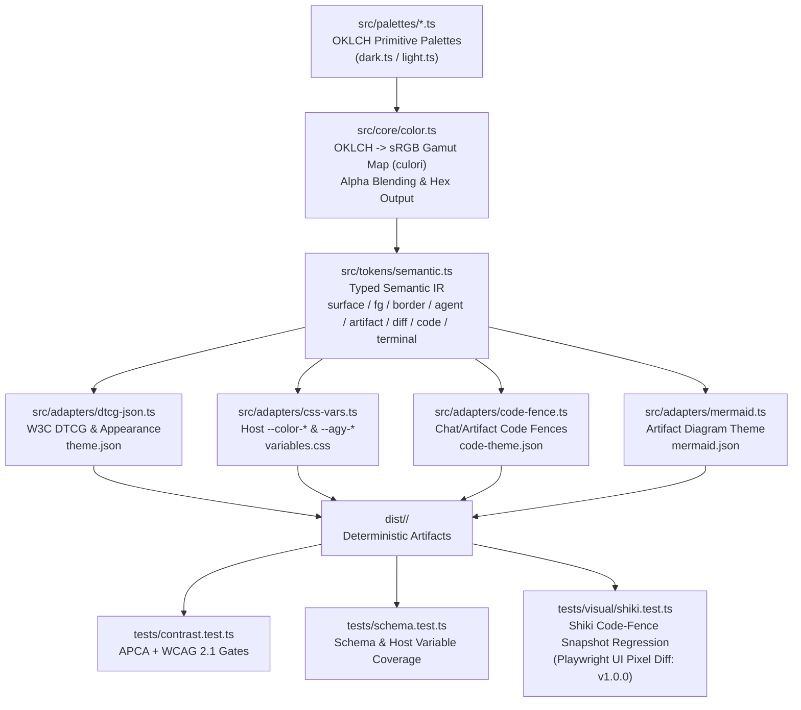

# 04 Technical Architecture & Engineering Spec

> [简体中文](../zh-CN/04-technical-architecture.md) | **English** | [Back to Docs Index](../README.md)

| Metadata | Details |
| :--- | :--- |
| **Target Software** | Antigravity 2.0 Agent Desktop App (Not a code editor) |
| **Core Stack** | TypeScript (ESM) + Node.js LTS (`>= 20`) + `pnpm` + `culori` + `apca-w3` + Vitest + Shiki (Playwright visual regression planned for `v1.0.0`) |
| **Core Artifacts** | Standardized Antigravity Theme Pack (W3C DTCG `theme.json` + host `variables.css` + embedded `code-theme.json` + `mermaid.json`) |
| **License** | MIT License |

---

## 1. System Architecture (Semantic IR + Multi-Format Adapters)

To bridge **Antigravity 2.0's documented host CSS variable protocol (`--color-*`)** today with **future official custom theme import schemas**, the compiler uses an **"OKLCH Source -> Typed Semantic IR -> Deterministic Output Adapters"** pipeline:



---

## 2. Repository Structure (Implemented Phase 1–2 Layout)

```text
antigravity-theme/
├─ README.md                         # English default overview
├─ README.zh-CN.md                   # Simplified Chinese overview
├─ LICENSE                           # MIT License text
├─ CHANGELOG.md                      # Changesets-managed release history
├─ CONTRIBUTING.md                   # English contributor guide (linked with docs/07)
├─ package.json                      # pnpm scripts, npm package manifest (@django9944/antigravity-theme), exports map
├─ tsconfig.json                     # Strict TypeScript configuration
├─ .upstream-baseline.json           # Upstream Antigravity changelog & host CSS variable baseline snapshot
├─ .changeset/                       # Changesets version & release metadata
├─ .github/
│  ├─ dependabot.yml                 # Weekly npm & GitHub Actions dependency updates
│  ├─ workflows/
│  │  ├─ ci.yml                      # PR/Push gates: typecheck + build + test + dist cleanliness + pack/offline smoke
│  │  ├─ release.yml                 # Automated Changesets Version PR / GitHub Release (ZIP + SHA-256) + npm OIDC
│  │  └─ upstream-sync.yml           # Weekly monitor of Antigravity App changelog & host CSS specs
│  ├─ ISSUE_TEMPLATE/                # Visual bug, variant RFC templates, and config.yml
│  └─ pull_request_template.md       # PR checklist (bilingual docs sync & preview screenshot verification)
├─ docs/                             # Complete 0-to-1 bilingual specification suite
│  ├─ README.md
│  ├─ zh-CN/                         # 01–07 Chinese docs
│  └─ en/                            # 01–07 English docs
├─ src/                              # Compiler implementation
│  ├─ core/
│  │  ├─ color.ts                    # OKLCH validation, toGamut gamut mapping, resolveShadow, and blendOver
│  │  ├─ contrast.ts                 # Signed APCA Lc & WCAG 2.1 contrast wrappers
│  │  ├─ json.ts                     # Plain-object recursive ASCII key sorting & deterministic JSON serialization
│  │  └─ types.ts                    # Strongly typed Palette / SemanticIR / GlassShadowSpec / ThemePack contracts
│  ├─ palettes/
│  │  ├─ dark.ts                     # Antigravity Dark OKLCH palette
│  │  └─ light.ts                    # Antigravity Light OKLCH palette
│  ├─ tokens/
│  │  └─ semantic.ts                 # Unified Primitive -> Agent Semantic IR derivation engine
│  ├─ adapters/
│  │  ├─ dtcg-json.ts                # W3C DTCG + $extensions['com.antigravity-theme'] theme.json emitter
│  │  ├─ css-vars.ts                 # Host --color-*, --agy-*, --agy-glass-*, --agy-code-* CSS emitter
│  │  ├─ code-fence.ts               # Shiki-compatible embedded code & Diff syntax emitter
│  │  └─ mermaid.ts                  # Artifacts Mermaid themeVariables emitter
│  ├─ variants.ts                    # Variant registry (single registration point for new flavors)
│  └─ build.ts                       # Deterministic CLI compiler entry point (atomic .dist-staging swap)
├─ dist/                             # Compiled outputs (committed to Git & verified in CI)
│  ├─ manifest.json                  # Global build manifest (SemVer, variant list, modes, artifact paths)
│  ├─ antigravity-dark/
│  │  ├─ theme.json
│  │  ├─ variables.css
│  │  ├─ code-theme.json
│  │  └─ mermaid.json
│  └─ antigravity-light/
│     ├─ theme.json
│     ├─ variables.css
│     ├─ code-theme.json
│     └─ mermaid.json
├─ preview/                          # Static 3-pane Antigravity 2.0 UI simulation workbench
├─ scripts/
│  ├─ check-upstream-app.ts          # Monitors antigravity.google/docs/changelog.md (supports --offline)
│  ├─ pack-release.ts                # Bundles versioned Theme Pack ZIP/tar.gz + SHA256SUMS.txt
│  └─ serve-preview.ts               # Hardened local preview HTTP server (strict path allowlist + 405/403/400 guards)
└─ tests/
   ├─ fixtures/                      # Embedded code-fence fixtures (14 language/config samples)
   ├─ contrast.test.ts               # Full contrast matrix unit tests (reads directly from dist/)
   ├─ schema.test.ts                 # DTCG Schema + 100% host --color-* & reduced-transparency block verification
   ├─ scripts.test.ts                # Color guardrails, APCA zero-crossing, upstream parser & pack-release tests
   └─ visual/
      └─ shiki.test.ts               # Shiki code-fence tokenization & color snapshots (Playwright planned for v1.0.0)
```

---

## 3. TypeScript + OKLCH Compiler Design

### 3.1 Strongly Typed Data Contracts (`src/core/types.ts`)

Raw hex literals are forbidden inside source palettes; every color is declared via `OklchColor`:

```ts
export interface OklchColor {
  readonly l: number;      // Perceptual lightness: 0.0 ~ 1.0
  readonly c: number;      // Chroma: 0.0 ~ 0.37
  readonly h: number;      // Hue angle in degrees: 0 ~ 360
  readonly alpha?: number; // Optional opacity: 0.0 ~ 1.0
}

export type ThemeMode = 'dark' | 'light' | 'hc-dark' | 'hc-light';

export interface VariantDefinition {
  readonly id: string;          // e.g. "antigravity-dark"
  readonly displayName: string; // e.g. "Antigravity Dark"
  readonly mode: ThemeMode;
  readonly palette: PrimitivePalette;
}
```

### 3.2 Perceptual Gamut Mapping & Alpha Compositing (`src/core/color.ts`)
- **Constant-L/H Gamut Conversion**: Call `culori`'s `toGamut('rgb', 'oklch', null, 0)` (disabling JND lightness drift tolerance) to strictly lock `L` and `H` while gently pulling out-of-gamut `C` onto the sRGB boundary, formatted as lowercase `#rrggbb` / `rgba(...)`; `oklch()`, `withAlpha()`, and `resolveShadow()` validate finite ranges explicitly.
- **Alpha Pre-Compositing**: Expose `blendOver(overlayRgba, backdropHex)` (throwing on translucent backdrops to prevent distortion) to compute effective opaque colors behind Thinking cards, 5-tier Alert fills, Diff washes, and Hover states for exact APCA/WCAG verification.

### 3.3 Deterministic Serialization (`src/build.ts` & `src/core/json.ts`)
1. Recursively sort all JSON keys in ASCII order via `sortKeysDeep()` (plain objects only) and group CSS custom properties into host `--color-*`, `--agy-*`, `--agy-glass-*`, `--agy-code-*`, etc., sorted alphabetically within each group;
2. Scope selectors via `[data-antigravity-theme="<id>"]` paired with `@media (prefers-color-scheme: ...)` wrapping zero-specificity `:where(:root:not([data-antigravity-theme]))` defaults;
3. Emit UTF-8 without BOM, POSIX LF, 2-space indentation, and a single trailing newline, swapped atomically into `dist/` via `.dist-staging`;
4. Generate a root `dist/manifest.json` indexing verified SemVer, unique variant IDs, modes, and artifact paths.

---

## 4. Antigravity 2.0 Host CSS Bridge & Safe Appearance Alignment

### 4.1 Complete Host CSS Variable Mapping (`src/adapters/css-vars.ts`)

`variables.css` maps 100% of Antigravity 2.0's documented host theme variables so the desktop shell, Artifacts, and embedded HTML panels / MCP Apps share one unified palette:

| Host Variable Group | Standard Variables | Semantic IR Source (Layer 2) |
| :--- | :--- | :--- |
| **Backgrounds** | `--color-background-primary`, `--color-background-secondary`, `--color-background-tertiary`, `--color-background-inverse`, `--color-background-disabled` | `surface.canvas`, `surface.shell`, `surface.card`, `fg.primary`, `surface.disabled` |
| **Semantic Backgrounds** | `--color-background-info`, `--color-background-danger`, `--color-background-success`, `--color-background-warning` | `status.info.bg`, `status.danger.bg`, `status.success.bg`, `status.warning.bg` |
| **Text Colors** | `--color-text-primary`, `--color-text-secondary`, `--color-text-tertiary`, `--color-text-inverse`, `--color-text-disabled`, `--color-text-info`, `--color-text-danger`, `--color-text-success`, `--color-text-warning` | `fg.primary`, `fg.secondary`, `fg.muted`, `fg.inverse`, `fg.disabled` & status foregrounds |
| **Borders** | `--color-border-primary`, `--color-border-secondary`, `--color-border-inverse`, `--color-border-info`, `--color-border-danger`, `--color-border-success`, `--color-border-warning` | `border.default`, `border.subtle`, `border.inverse` & status borders |
| **Focus Rings** | `--color-ring-primary`, `--color-ring-info`, `--color-ring-danger`, `--color-ring-success`, `--color-ring-warning` | `border.focusRing` & status focus rings |
| **Agent & Code Extensions (`--agy-*`)** | `--agy-thinking-*`, `--agy-tool-*`, `--agy-approval-*`, `--agy-subagent-*`, `--agy-diff-*`, `--agy-code-*`, `--agy-mermaid-*`, `--agy-terminal-ansi-*` | Fine-grained tokens for Thinking, Tool Cards, Approvals, Subagents, Diffs, fenced code, Mermaid & 16-color terminal |
| **Frosted Glass Tokens (`--agy-glass-*`)** | `--agy-glass-bg-{shell,canvas,card,popover}`, `--agy-glass-blur-{sm,md,lg}`, `--agy-glass-saturate-{shell,canvas,popover}`, `--agy-glass-backdrop-{shell,canvas,popover}`, `--agy-glass-rim-top`, `--agy-glass-rim-border`, `--agy-glass-shadow-{card,popover}` | Controls 4-tier glass translucency, composite blur+saturation backdrop filters, top/directional specular rims, plus automatic `@media (prefers-reduced-transparency: reduce)` opaque fallbacks and `backdrop: none` |

### 4.2 Safe, Zero-Tamper Delivery & Official Import Readiness

- **Zero Binary Tampering**: This repository strictly excludes Electron `asar` unpacking, binary patching, or macOS code-signature workarounds.
- **Practical Adoption Path**:
  1. Ships as a standardized **Antigravity Appearance Theme Pack** (`theme.json` + `variables.css` + `code-theme.json` + `mermaid.json`) ready for visual validation in the 3-pane preview harness, instant theme sync in MCP Apps / custom UI panels, and community theme proposals to Antigravity;
  2. Whenever Antigravity 2.0 exposes a formal third-party custom theme import manifest under `Settings > Appearance` or `~/.gemini/config/`, we simply add one thin compiler adapter under `src/adapters/` without rewriting palettes or tests.

---

## 5. Architecture Decision Records (ADRs)

### ADR-001: Exclusive Antigravity 2.0 Agent Focus & Zero-Tamper Policy
- **Status**: Accepted
- **Context**: Antigravity 2.0 is a standalone Electron Agent desktop app, not a code editor with a `.vsix` theme marketplace.
- **Decision**: Scope strictly to Antigravity 2.0 Agent surfaces and official host protocols; permanently forbid binary patching or client injection hacks.
- **Rationale**: Protects user security, app integrity, and long-term survival across automatic desktop updates.

### ADR-002: TypeScript + OKLCH (`culori`) Token Compiler
- **Status**: Accepted
- **Decision**: Author palettes in TypeScript using `culori` for OKLCH -> sRGB gamut mapping and `apca-w3` for contrast validation.
- **Rationale**: Static typing prevents misspelled tokens; OKLCH keeps Dark/Light and 5-tier status hues perceptually balanced.

### ADR-003: Semantic IR + Multi-Format Adapters
- **Status**: Accepted
- **Decision**: Compile `theme.json` (W3C DTCG), `variables.css` (`--color-*` + `--agy-*`), `code-theme.json`, and `mermaid.json` from one shared `SemanticIR`.
- **Rationale**: Decouples visual craft from evolving host import formats—new output targets require only a thin adapter.

### ADR-004: MIT License & 1:1 Mirrored Bilingual Documentation
- **Status**: Accepted
- **Decision**: License all code, tokens, and docs under **MIT License** and mirror `docs/zh-CN/` and `docs/en/` 1:1.
- **Rationale**: Zero legal friction for community reuse while welcoming both Chinese- and English-speaking contributors.

### ADR-005: Changesets + GitHub Releases & npm Distribution
- **Status**: Accepted
- **Decision**: Use Changesets for SemVer + `CHANGELOG.md` and GitHub Actions to publish versioned Theme Pack ZIPs (with SHA-256) on GitHub Releases alongside `@django9944/antigravity-theme` on npm.
- **Rationale**: Serves both end users downloading Theme Packs directly and Antigravity ecosystem builders importing tokens/CSS via npm.

### ADR-006: v1.0 Visual Direction — Option A (Orbital Slate / Orbital Cloud High-Opacity Matte Glass)
- **Status**: Accepted (Approved 2026-11-21)
- **Context**: After evaluating Candidates A (Orbital Slate), B (Nebula Pulse), and C (Precision Lab) alongside two glass-opacity render iterations, lock the canonical v1.0 visual baseline.
- **Decision**: Adopt **Option A** as the canonical v1.0 aesthetic paired with **High-Opacity Matte Frosted Glass**:
  - **`Antigravity Dark` (Orbital Slate Matte Glass)**: Cool slate-blue dark base (`L = 0.20–0.23, C = 0.014–0.018, H ≈ 255°`), Weightless Cobalt primary accent (`H ≈ 250°, C = 0.14`) with soft violet secondary (`H ≈ 290°`), Sidebar `α = 0.84–0.88` / Reading Canvas `α = 0.92–0.96`.
  - **`Antigravity Light` (Orbital Cloud Matte Glass)**: Airy cloud-porcelain base (`L = 0.975–0.985, C = 0.006–0.010, H ≈ 245°`), deep charcoal-slate prose (`L = 0.26`), Sidebar `α = 0.86–0.90` / Reading Canvas `α = 0.94–0.97`.
  - **Accessibility Floor**: Worst-case pure-white/pure-black wallpaper compositing holds primary text at `APCA Lc >= 70`, paired with mandatory `@media (prefers-reduced-transparency: reduce)` opaque fallbacks.
- **Rationale**: Delivers optimal all-day reading ergonomics across long-form Artifacts and concurrent multi-agent orchestration with unmatched Dark/Light cohesion. Option B (Nebula Pulse) remains a candidate for future community flavor expansion.

---

> **Next Document**: [05 QA, Accessibility & Visual Testing Plan](./05-qa-testing-plan.md)
