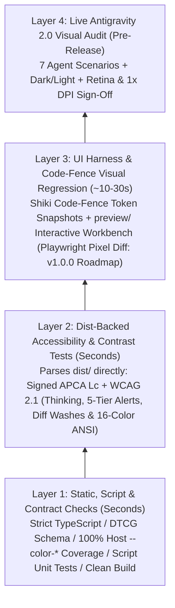

# 05 QA, Accessibility & Visual Testing Plan

> [简体中文](../zh-CN/05-qa-testing-plan.md) | **English** | [Back to Docs Index](../README.md)

| Metadata | Details |
| :--- | :--- |
| **Related Architecture** | [04 Technical Architecture](./04-technical-architecture.md) |
| **Target Software** | Antigravity 2.0 Agent Desktop App |
| **Test Stack** | Vitest + `apca-w3` + `culori` + Structural DTCG/CSS Assertions + Shiki (Playwright visual regression planned for `v1.0.0`) |
| **Quality Gate Policy** | Any failing CI check blocks PR merge; live App visual sign-off is mandatory before Minor/Major releases |

---

## 1. Four-Layer Quality Pyramid

In a dense multi-agent desktop workbench, any contrast drift, over-saturated Alert tint, or buried approval banner degrades orchestration accuracy. Antigravity Theme enforces a **4-layer quality pyramid**:

---

## 2. Layer 1: Static Types, Schema & Host Protocol Coverage (`tests/schema.test.ts`)

Runs automatically on every PR and push to `main`:

| Gate | Assertion Scope | Failure Condition |
| :--- | :--- | :--- |
| **Strict TypeScript** | `tsc --noEmit` passes with zero errors and no implicit `any` | Any type error |
| **DTCG Schema & Manifest** | Validates every `dist/<variant>/theme.json` and `dist/manifest.json` conforms strictly to W3C DTCG structure and `package.json#exports` parity | Missing required field, key-order drift, or export mismatch |
| **100% Host CSS Coverage** | Parses `dist/<variant>/variables.css` per rule block and asserts all 30 documented host color variables (`--color-background-*`, `--color-text-*`, `--color-border-*`, `--color-ring-*`), `--font-sans`/`--font-mono`, 18 `--agy-glass-*` tokens, and all `--agy-*` / `--agy-code-*` variables are present and valid, with opaque `@media (prefers-reduced-transparency: reduce)` fallbacks | Missing variable, invalid hex/rgba, or translucent fallback |
| **Mermaid & Code-Fence Validity** | Validates `mermaid.json` and `code-theme.json` contain all required roles with lowercase hex values | Missing keys or invalid hex |
| **Zero-Tamper & Symlink Purity Gate** | Uses `lstatSync` to verify `dist/` and release bundles contain no symlinks and strictly static JSON/CSS/metadata, backed by `tests/scripts.test.ts` unit coverage | Unauthorized file types, symlinks, or script test failures |
| **Deterministic Build Freshness** | Consecutive `pnpm build` outputs produce identical SHA-256 digests, and CI checks `git status --porcelain dist/` for clean sync | Source changed without committed `dist/` rebuild |

---

## 3. Layer 2: Automated Contrast & Accessibility Tests (`tests/contrast.test.ts`)

Reads directly from compiled `dist/<variant>/` outputs to validate every variant against the dual thresholds defined in [03 Visual Design System](./03-visual-design-system.md#22-dual-model-contrast-enforcement-baselines):

### 3.1 Core 3-Pane & Interactive Solid Matrix
- **Left-hand Sidebar**: `fg.primary` / `fg.secondary` / `fg.muted` vs `surface.shell` and `surface.selected`.
- **Chat Canvas**: User prompt text vs `agent.userBubbleBg`; Agent prose & links vs `surface.canvas`; `/` Slash & `@` Mention popover rows vs `surface.elevated`.
- **Thinking Blocks**: `agent.thinkingFg` vs `agent.thinkingBg` clears the legibility floor (`|Lc| >= 45`) while remaining visually subordinate to primary prose.
- **Tool Calls & Permission Approvals**: `Running`, `Done`, `Needs Approval`, and `Error` badges and buttons clear `|Lc| >= 58` (`WCAG >= 4.5:1`) on their respective card surfaces.

### 3.2 Frosted Glass & Alpha-Composited Overlay Contrast
For translucent glass tiers (Elevation 0–3) and overlays (5-tier Artifact Alerts, Files Changed line/word Diff fills, hover overlays):
1. **Worst-Case Wallpaper Envelope**: Composite every high-opacity matte glass surface over both `#ffffff` and `#000000` via `blendOver(glassRgba, extremeBg)`, asserting primary text clears `|Lc| >= 70` in extremes (`>= 78` on balanced backdrops);
2. **Reduced-Transparency Fallback Check**: Assert `variables.css` declares `@media (prefers-reduced-transparency: reduce)` with opaque fallbacks passing standard contrast gates;
3. Assert all 5 Alert titles (`|Lc| >= 60`) and bodies (`|Lc| >= 75`) pass over their composited tints, and embedded code tokens retain `|Lc| >= 55` over Diff washes.

### 3.3 Terminal 16-Color ANSI & Mermaid Diagrams
- Validate all 16 `terminal.ansi*` colors against terminal background: all 14 functional slots (excluding the background-polarity anchor) must clear `|Lc| >= 50` (primary chromatic colors `>= 60`).
- Assert Mermaid node text vs node fill clears `|Lc| >= 65` and edge strokes vs canvas clear `|Lc| >= 30`.

---

## 4. Layer 3: Antigravity 3-Pane UI Harness & Shiki Visual Regression (`tests/visual/`)

### 4.1 Antigravity 2.0 Simulation Workbench (`preview/`)
Because the Antigravity 2.0 desktop client cannot be launched inside standard headless CI containers, `preview/` provides a faithful static HTML/CSS simulation workbench wired directly to compiled `dist/<variant>/variables.css`, `code-theme.json`, and `mermaid.json`. It renders:
- Left-hand Sidebar (Conversations, Projects, Scheduled Tasks, Skills, Settings Appearance)
- Central Chat Canvas (User prompt, Agent Markdown reply, collapsed/expanded Thinking trace, Running/Approval/Error Tool Cards, `/` & `@` popovers)
- Right-hand Auxiliary Pane tabs (Subagents tree, Background Tasks, Artifact with 5-tier Alerts/Mermaid/KaTeX/Carousel, Files Changed Diff, 16-color Terminal)

### 4.2 Dual-Track Automated Regression
1. **Playwright Visual Snapshots**: Captures Dark and Light desktop viewports (1440×900) of `preview/` in CI, uploading pixel-diff artifacts whenever thresholds trip for fast visual PR review.
2. **Shiki Code-Fence Token Regression (`tests/visual/shiki.test.ts`)**: Consumes compiled `dist/<variant>/code-theme.json` and snapshots `codeToTokens()` outputs across 14 Tier-1 fixtures in `tests/fixtures/` (TS/TSX, Python, Go, Rust, Java, HTML/CSS, JSON/YAML/TOML, Markdown, Shell, Unified Diff) to catch unintended syntax shifts (automated Playwright UI pixel-diff `pnpm test:visual` is scheduled for `v1.0.0` GA; pair with `pnpm preview` during pre-GA visual reviews).

---

## 5. Layer 4: Live Antigravity 2.0 Visual Sign-Off Checklist

Before every Minor or Major release, a maintainer reviews both **Dark** and **Light** variants alongside the latest stable **Antigravity 2.0 Desktop App**:

- [ ] **3-Pane Elevation**: Smooth luminance separation across Left Sidebar, Chat Canvas, and Auxiliary Pane—zero harsh black slabs or glaring pure white.
- [ ] **Thinking & Tool Cards**: Thinking blocks stay quiet relative to final prose; `Needs Approval` and `Error` cards stand out immediately in long threads.
- [ ] **Subagents & Background Tasks**: Clear visual distinction across `working`, `waiting`, `stopped`, and `killed` states with zero visual clutter.
- [ ] **Rich Artifacts**: Inspect H1–H6, all 5 Alert tiers (`NOTE`, `TIP`, `IMPORTANT`, `WARNING`, `CAUTION`), Mermaid diagrams, KaTeX math, and Carousel controls.
- [ ] **Files Changed Diff**: Audit a 30+ line multi-file diff confirming gentle washes and readable embedded syntax.
- [ ] **Terminals & Host CSS Bridge**: Verify 16-color ANSI legibility and seamless `--color-*` inheritance inside embedded HTML / MCP App panels.
- [ ] **Multi-DPI Crispness**: Verify hairline borders, focus rings, and text rendering on both macOS Retina and standard 1x displays.

---

> **Next Document**: [06 Release, Maintenance & Upstream Sync Runbook](./06-release-maintenance-runbook.md)
