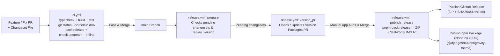
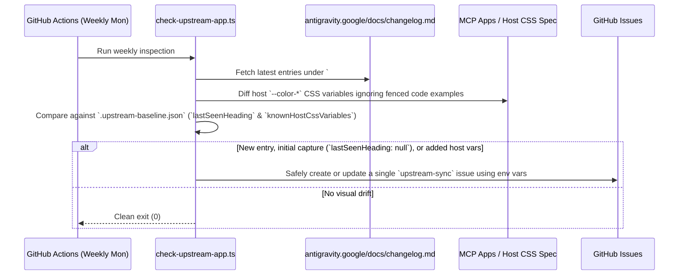

# 06 Release, Maintenance & Upstream Sync Runbook

> [简体中文](../zh-CN/06-release-maintenance-runbook.md) | **English** | [Back to Docs Index](../README.md)

| Metadata | Details |
| :--- | :--- |
| **Related Specs** | [04 Technical Architecture](./04-technical-architecture.md) · [05 QA & Testing Plan](./05-qa-testing-plan.md) |
| **Target Software** | Antigravity 2.0 Agent Desktop App |
| **CI/CD Stack** | GitHub Actions + Changesets |
| **Release Channels** | GitHub Releases (Versioned Theme Pack ZIP + SHA-256) + npm (`@django9944/antigravity-theme`) |

---

## 1. Branching Model & End-to-End CI/CD Pipeline

We follow **Trunk-Based Development** on `main`, with every change validated through automated PR gates:

### 1.1 Mandatory PR & Push Gates (`ci.yml`)
1. `pnpm install --frozen-lockfile` (with `persist-credentials: false` on checkout)
2. `pnpm typecheck` (`tsc --noEmit`)
3. `pnpm build` (deterministically compile all `dist/` formats)
4. `test -z "$(git status --porcelain dist/)"` (verify committed artifacts—including untracked files—match source byte-for-byte)
5. `pnpm test` (Vitest: schema, 100% host `--color-*` & `--font-*` coverage, signed APCA/WCAG contrast matrix, script/packer unit tests, and Shiki code-fence snapshots)
6. `pnpm check:upstream -- --offline` & `pnpm pack:release` (offline baseline parser check + Theme Pack ZIP & `SHA256SUMS.txt` smoke check)
7. *(Roadmap `v1.0.0`)*: `pnpm test:visual` (Playwright Dark/Light pixel-diff regression of `preview/` 3-pane workbench)

---

## 2. Theme Pack Semantic Versioning Policy

| Bump Level | Example | Qualifying Changes | Migration Notes Required |
| :--- | :--- | :--- | :---: |
| **Patch (`0.0.x`)** | `1.0.1` | Micro contrast adjustments (`ΔL <= 0.02`), newly added Antigravity App status tokens, single-language code-fence fixes, Mermaid/Alert refinements, doc fixes | No |
| **Minor (`0.x.0`)** | `1.1.0` | New theme variants (High Contrast / Soft Dim), new output adapter (e.g., official Antigravity custom theme import manifest), full styling for a new Auxiliary Pane view | Brief highlight summary |
| **Major (`x.0.0`)** | `2.0.0` | Reworking core 3-pane surface bases or primary accent hues, renaming/removing public `--agy-*` or `theme.json` keys, changing Theme Pack layout | **Mandatory** before/after comparisons & migration guide |

> **Hard Contract**: Standard Antigravity host variables (`--color-background-*`, `--color-text-*`, `--color-border-*`, `--color-ring-*`) strictly follow upstream specifications and are never arbitrarily renamed.

---

## 3. Release Procedure & Secrets SOP

### 3.1 One-Time Onboarding
1. **GitHub Releases**: Uses the built-in least-privilege `GITHUB_TOKEN` (scoped to `contents: write` exclusively inside `release.yml`).
2. **npm Registry (`@django9944/antigravity-theme`)**:
   - Ensure access to the `@django9944` npm scope (lowercase GitHub username scope);
   - Configure **npm Trusted Publishing (OIDC)** on **Node 24 + npm (`>= 11.5.1`)** with zero long-lived `NPM_TOKEN` secrets (omit `registry-url` in `actions/setup-node` to avoid overriding OIDC);
   - Ship with `package.json#publishConfig` (`access: "public"`, `provenance: true`) via `pnpm ci:publish` for supply-chain provenance attestation.

### 3.2 Build Once, Publish Synchronously (`release.yml` Three-Job Pipeline)
`release.yml` cleanly separates `prepare`, `version_pr`, and `publish_release`:
1. When pending changesets exist on `main`, `prepare -> version_pr` creates or updates the `Version Packages` PR;
2. When that PR merges (no pending changesets and version tag absent), `prepare -> publish_release` runs `pnpm typecheck`, `pnpm build`, `pnpm test`, `pnpm check:upstream -- --offline`, and `pnpm pack:release` to emit `release/antigravity-theme-v${VERSION}.zip` and `release/SHA256SUMS.txt`;
3. Attaches the ZIP and `SHA256SUMS.txt` to the GitHub Release, and publishes `@django9944/antigravity-theme` to npm via Node 24 OIDC (`pnpm ci:publish`);
4. **Idempotent Retry**: If either channel fails transiently, trigger `release.yml` via `workflow_dispatch` with `replay_version` and `target` (`both` | `github` | `npm`) to replay only the failed target without bumping versions again.

### 3.3 Secret Security & Environment Protection
- Bind `publish_release` to a protected GitHub Environment (`production-release`) restricted strictly to `main`; fork PRs never access OIDC publishing claims;
- All npm releases authenticate via ephemeral OIDC tokens (zero long-lived `NPM_TOKEN` secrets stored).

---

## 4. Automated Antigravity App Changelog & Host Spec Monitoring

Antigravity 2.0 ships frequent updates that may introduce new sidebar sections, Auxiliary Pane views, approval UI patterns, or new `--color-*` host CSS variables.

### 4.1 Monitor Workflow (`scripts/check-upstream-app.ts`)

> Note: When `lastSeenHeading` is initialized as `null` in `.upstream-baseline.json`, the first online sync captures the latest upstream heading for baseline recording; CI executes `pnpm check:upstream -- --offline` to verify parser rules offline.

### 4.2 Adaptation SLA
- **Official Appearance import updates or new `--color-*` host variables**: implement adapter/mapping, contrast tests, and ship Patch/Minor release within **7 days**.
- **New Antigravity App panes or interactive states**: update the `preview/` harness, add semantic tokens, and refresh Playwright baselines.
- **Deprecated upstream keys**: keep backward-compatible mappings for at least **2 Minor releases** before cleanup.

---

## 5. Maintenance Cadence & Incident Runbook

### 5.1 Routine Cadence
- **Weekly**: Review `upstream-sync.yml` reports and Dependabot security PRs (npm dependencies and SHA-pinned GitHub Actions).
- **Monthly**: Batch verified contrast or component fixes into a Patch release as needed.
- **Quarterly**: Review community feedback and official Antigravity Appearance capabilities, audit secret hygiene, and advance roadmap milestones.

### 5.2 Incident Response & Rollback Procedures

| Incident | Severity | Standard Operating Procedure (SOP) |
| :--- | :---: | :--- |
| **A: Severe contrast regression or missing CSS variable shipped** | P0 | 1. Branch `hotfix/vX.Y.Z+1`; 2. Fix defect and add regression contrast/schema tests; 3. Add Patch Changeset and merge for a **Roll-Forward Patch Release**; 4. Run `npm deprecate` on the broken version and annotate the GitHub Release. |
| **B: Single-channel (GitHub Release or npm) publish failure** | P1 | 1. Inspect failed job logs (OIDC claim or transient 5xx); 2. Replay only the failed channel via `release.yml` `workflow_dispatch` with `replay_version` and `target` (`github` or `npm`) using the same artifact build. |
| **C: Suspected publish credential exposure** | P0 | 1. **Immediately revoke** the token in npm settings; 2. Audit recent packages and GitHub Release SHA-256 sums + provenance attestations; 3. Migrate to OIDC Trusted Publishing or rotate token, then file a postmortem. |

---

> **Next Document**: [07 Open-Source Governance, Contributing & Roadmap](./07-governance-roadmap.md)
