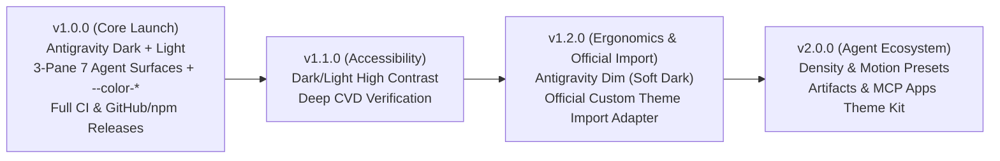

# 07 Open-Source Governance, Contributing & Roadmap

> [简体中文](../zh-CN/07-governance-roadmap.md) | **English** | [Back to Docs Index](../README.md)

| Metadata | Details |
| :--- | :--- |
| **Target Software** | Antigravity 2.0 Agent Desktop App (Excludes code editors) |
| **License** | MIT License |
| **Docs Sync Policy** | 1:1 mirrored bilingual docs (`docs/en/` & `docs/zh-CN/`) |
| **Community Channels** | GitHub Issues (bugs & upstream sync) · GitHub Discussions (aesthetic RFCs & Q&A) |

---

## 1. Governance Model & Roles

Antigravity Theme operates on transparent, pragmatic **Maintainer Consensus**:

| Role | Responsibilities | Access & Appointment |
| :--- | :--- | :--- |
| **Project Lead** | Guards visual philosophy and long-term roadmap, approves Major changes and releases | Repository Admin & `production-release` approver |
| **Core Maintainers** | PR reviews, contrast & visual regression stewardship, Antigravity App upstream sync, issue triage | Invited by Project Lead after sustained high-quality contributions; merge access |
| **Contributors** | Contrast fixes, UI harness scenarios, new variant RFCs, code-fence refinements, bilingual docs | Anyone adhering to the Code of Conduct and passing CI |

---

## 2. Licensing & Legal Compliance (MIT)

1. **Permissive Terms**: All source code, OKLCH Design Tokens, compiled artifacts (`theme.json`, `variables.css`, `code-theme.json`, `mermaid.json`), simulation harness, and documentation are licensed under the **MIT License**—permitting free use, modification, redistribution, and commercial adoption with copyright and permission notices intact.
2. **Required Repository Files** (created in Phase 1):
   - Root `LICENSE` file (`Copyright (c) 2026 Antigravity Theme Contributors`);
   - `"license": "MIT"` declared in `package.json` for accurate display on GitHub and npm;
   - `scripts/pack-release.ts` bundles `LICENSE` inside every distributed Theme Pack ZIP.
3. **Inbound = Outbound Contributions**: All pull requests are accepted under the MIT License without requiring a separate CLA, keeping contribution friction minimal.
4. **Dependency Hygiene**: All build/test libraries (`culori`, `apca-w3`, `shiki`, `vitest`, and `playwright` once added for `v1.0.0`) live exclusively in `devDependencies` (zero runtime dependencies in published theme assets) and must use permissive compatible licenses (MIT / Apache-2.0 / BSD).

---

## 3. Contributing Workflow & Bilingual Docs Policy

### 3.1 Standard PR Workflow
1. **Discuss Before Major Visual Shifts**: Open a concise RFC in GitHub Discussions before proposing new variants or core surface palette shifts. Targeted contrast fixes, component refinements, or newly added host variables may open a PR directly.
2. **Never Hand-Edit Compiled Outputs**: Make all edits inside `src/`, run `pnpm build && pnpm test` to regenerate `dist/` and Shiki snapshots, and inspect changes in `pnpm preview` (automated Playwright `pnpm test:visual` joins at `v1.0.0`).
3. **Attach a Changeset**: User-facing visual or token changes must include a `pnpm changeset` summary.
4. **Visual Evidence**: PRs touching colors or surface hierarchy must include Before/After screenshots from the `preview/` 3-pane workbench.

### 3.2 Bilingual Documentation Synchronization
- PRs changing architectural decisions, requirements, QA gates, or release procedures should update both `docs/en/` and `docs/zh-CN/` in the same PR.
- External contributors comfortable in one language may merge with the `docs-sync` label so a maintainer mirrors the counterpart within 7 days.

---

## 4. Visual & Component Bug Triage SOP

Standardized templates separate objective visual defects from personal preference tweaks and out-of-scope requests:

### 4.1 Mandatory Reproduction Fields (Issue Template)
Bug reports must include:
1. **Theme Variant**: `Antigravity Dark` or `Antigravity Light`;
2. **Environment**: Antigravity 2.0 Desktop App version, OS, and display scaling factor;
3. **Affected Surface**: Left Sidebar / Chat Canvas / Thinking Block / Tool Cards & Approvals / Subagents / Background Tasks / Artifacts (Alert / Mermaid / KaTeX) / Files Changed Diff / Terminals;
4. **Screenshot & Description**: Clearly indicate illegible text or imbalanced contrast regions.

### 4.2 Triage Decision Matrix

| Category | Criteria | Action & Priority |
| :--- | :--- | :--- |
| **Objective Defect (P0 / P1)** | Violates APCA/WCAG baselines, ambiguous Thinking/Tool/Approval states, unreadable 5-tier Alerts or Diffs, missing upstream host CSS variable | Label `bug` + `confirmed`; fix in next Patch release with regression test & harness case |
| **Surface Enhancement (P2)** | Additional Artifact diagram types, richer MCP App styling, or extra embedded code-fence languages | Label `enhancement`; welcome community PR with preview fixture |
| **Subjective Preference** | E.g., "make the primary accent green / warmer card tint" | Guide users cleanly to local CSS variable overrides (`variables.css`) and curate community snippets in Discussions |
| **Non-Target Editor or Binary Patch Requests** | Requests for code editors (Antigravity IDE, VS Code, Cursor, etc.) or Electron binary injection/patching scripts | Label `out-of-scope`, politely reiterate Antigravity 2.0 Agent-only & zero-tamper policy, and close |

---

## 5. Admission Criteria for New Variants & Official Adapters

### 5.1 Adding a New Theme Variant (e.g., High Contrast / Soft Dim)
1. Must reuse Layer 2 Semantic IR and all Layer 3 adapters: add `src/palettes/<variant>.ts`, register it in `src/variants.ts`, expose matching subpath entries in `package.json#exports`, and add switcher entries in `preview/` (`preview/index.html` and `preview/app.js`);
2. Must clear all automated APCA / WCAG gates for its tier (`hc-dark` / `hc-light` use opaque high-contrast surfaces and stricter readability thresholds);
3. Must pass full visual inspection across all 7 Agent scenarios in `pnpm preview` (plus Playwright pixel baselines once `v1.0.0` automation lands) with explicit ongoing maintenance commitment.

### 5.2 Adding an Official Export Adapter
- When Antigravity 2.0 ships a formal third-party custom theme import schema, add an isolated module under `src/adapters/` paired with validation rules in `tests/schema.test.ts` without breaking existing `theme.json` or `variables.css` contracts.

---

## 6. Long-Term Product Roadmap

| Milestone | Planned Focus | Key Success Gate |
| :--- | :--- | :--- |
| **v1.0.0** | Core Dark & Light variants, all 7 Antigravity 2.0 Agent surfaces, 100% host `--color-*` coverage, APCA + 3-pane Playwright regression CI, GitHub Releases + npm launch, App changelog upstream monitor | All Phase 0–4 exit criteria satisfied |
| **v1.1.0** | Ship `Antigravity Dark High Contrast` and `Antigravity Light High Contrast` (`hc-dark` / `hc-light`) | Full WCAG AAA, crisp high-contrast borders & deep CVD validation |
| **v1.2.0** | Ship low-glare `Antigravity Dim`; integrate official Antigravity 2.0 custom theme import adapter and newly introduced Auxiliary Pane surfaces | Growing community PR share; seamless official import compatibility |
| **v2.0.0** | Expand into typography density / conversation-width / motion presets and an ecosystem-ready Artifacts & MCP Apps theme kit | Cohesive open-source visual design suite for Antigravity Agent Desktop |

---

> **Specification & Implementation Status**: All 7 foundational 0-to-1 specifications are aligned with the implemented codebase. [`ADR-006`](./04-technical-architecture.md#adr-006-select-option-a-high-opacity-matte-frosted-glass-as-visual-baseline) approved **Option A (`Antigravity Dark` + `Antigravity Light` High-Opacity Matte Glass)** across compiler, outputs, test suite, and CI/CD. Return to the [Documentation Index](../README.md) or review [03 Visual Design System](./03-visual-design-system.md).
