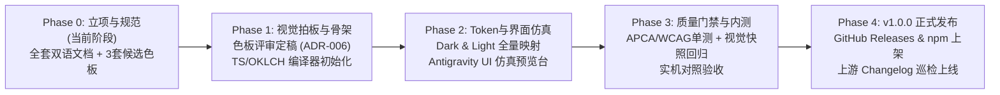

# 01 项目立项书（Project Charter）

> **简体中文** | [English](../en/01-project-charter.md) | [返回文档索引](../README.md)

| 元信息 | 内容 |
| :--- | :--- |
| **项目名称** | Antigravity Theme (`antigravity-theme`) |
| **文档版本** | v1.0.0-draft |
| **创建日期** | 2026-11-21 |
| **开源协议** | MIT License |
| **目标软件** | Antigravity 2.0 Agent 桌面端应用（唯一目标软件，不包含任何代码编辑器） |
| **发布渠道** | GitHub Releases（标准化 Theme Pack：JSON + CSS Variables）& npm (`@django9944/antigravity-theme`) |

---

## 1. 项目背景与动机

### 1.1 行业痛点：智能体工作台缺乏专属视觉主题体系

随着 **Antigravity 2.0（独立 Agent 桌面端应用）** 成为开发者与知识工作者的日常主力编排中枢，人机交互的主阵地已经从“代码编辑器”转向“多智能体并发工作台（Agent Workbench）”：

1. **信息密度与状态层级截然不同**：用户不再只是盯着代码行，而是在**左侧导航（Projects / Conversations / Scheduled Tasks / Skills & Customizations）**、**中央对话画布（Chat Canvas：推理过程 Thinking、工具调用卡片、权限审批横幅、`/` 命令与 `@` 引用）**以及**右侧辅助面板（Auxiliary Pane：Subagents、Background Tasks、Artifacts、Files Changed Diff、Terminals、Browser Pane）**之间高频切换。
2. **富媒体与文档长时阅读疲劳**：Agent 产出的核心交付物大量以 **Artifacts**（长篇 Markdown 报告、5 级 GitHub Alerts、Mermaid 架构图、KaTeX 数学公式、Carousel 对比视图）及 **Files Changed Diff** 形式呈现。默认通用深浅色模式在对比度层次、长文阅读护眼度和图表配色统一性上仍有巨大精进空间。
3. **内置外观选择有限、缺乏社区标准化主题包**：当前 Antigravity 2.0 通过 `Settings > Appearance` 仅提供少量内置主题（如 Light / Dark / Auto / Nord），社区尚无一套以 **感知色彩科学（OKLCH）** 和 **无障碍对比度门禁（APCA + WCAG 2.1）** 驱动的标准化外观配置与主题包规范。
4. **宿主与内嵌 UI 面板视觉割裂风险**：Antigravity 2.0 通过标准 CSS 变量协议（`--color-background-*`、`--color-text-*`、`--color-border-*`、`--color-ring-*`）向内嵌 HTML 面板与 MCP Apps 传递主题状态。缺乏统一的三层 Design Token 体系，会导致主界面、Artifacts 嵌入组件与插件 UI 出现色温不齐、对比度漂移。

### 1.2 项目愿景

打造一套**专为 Antigravity 2.0 Agent 桌面端设计的开源标杆级外观配置与换肤主题包体系**：

- 以 **OKLCH 感知色彩空间** 与 **APCA + WCAG 2.1 双对比度模型** 为科学基石；
- 深度建模 **Agent 多面板、多状态协同交互语法**；
- 输出标准化、零侵入、官方合规的 **Theme Pack（JSON 配置规范 + CSS Custom Properties + 内嵌代码块高亮表）**，并构建全自动化视觉回归与上游同步流水线。

---

## 2. 项目定位、目标与非目标

### 2.1 核心定位

- **产品形态**：面向 Antigravity 2.0 Agent 客户端的标准化外观配置与换肤主题包（Theme Pack），包含：
  1. 结构化主题配置清单（`theme.json`，对齐 W3C Design Tokens 与 Antigravity Appearance 语义模型）；
  2. 完整 CSS 主题变量表（`variables.css`，完整映射 Antigravity 宿主 `--color-*` 协议与三区表面 Token）；
  3. 对话与 Artifacts 内嵌代码块高亮主题（供 Markdown / Shiki 代码围栏渲染使用）。
- **目标受众**：重度使用 Antigravity 2.0 桌面端进行智能体编排、任务自动化、研究分析与工程审阅的全球用户与开源贡献者。
- **社区性质**：采用 **MIT License** 开源，维护 1:1 平行中英双语文档，面向全球社区开放共建。

### 2.2 v1.0 核心目标（Goals）

1. **核心双变体交付**：发布 `Antigravity Dark` 与 `Antigravity Light` 两套主主题，并在 Token 架构上原生预留 High Contrast（高对比度）与 Soft Dim（柔光护眼）变体扩展点。
2. **Antigravity 2.0 全界面完整建模**：100% 覆盖 Left-hand Sidebar、Chat Canvas、Auxiliary Pane（Subagents / Background Tasks / Artifacts / Files Changed / Terminals / Browser Pane）与宿主 CSS 变量桥接。
3. **工程化单一事实源（SSOT）**：建成 TypeScript + OKLCH Design Token 编译器，确定性编译生成全部 JSON / CSS / 代码高亮产物，严禁手工改写编译产物。
4. **可验证的视觉质量**：所有文本、状态徽章、Thinking/Tool 卡片、Artifacts Alert、Diff 叠层与终端 16 色通过 APCA + WCAG 2.1 自动化对比度门禁；基于仿真界面工作台完成自动化视觉快照回归。
5. **合规交付与自动化运维闭环**：严格遵循官方配置边界（绝不篡改客户端二进制），建立 Changesets 自动发布（GitHub Releases + npm）与 Antigravity App 更新日志上游巡检机制。

### 2.3 明确非目标（Non-Goals for v1.0）

| 非目标项 | 排除原因 | 后续归属 |
| :--- | :--- | :--- |
| **适配任何代码编辑器（含 Antigravity IDE、VS Code、Cursor、JetBrains、Neovim）** | 本项目严格对齐 **Antigravity Agent（Antigravity 2.0 桌面端）**，不是代码编辑器配色插件，不构建 `.vsix`、不发布 Open VSX / VS Code Marketplace | 明确不做（长期排除） |
| **破解、注入或篡改 Electron 客户端二进制/应用签名** | 违反安全合规红线，且每次客户端自动更新都会导致注入失效或破坏应用完整性；本主题包严格对齐官方配置与未来官方自定义主题导入协议 | 明确不做（永久红线） |
| **自定义桌面图标 / 品牌重绘（Icon Pack）** | 图标设计与维护成本独立，v1.0 聚焦色彩体系、对比度与组件语义层级 | 归入 v2.0 路线图评估 |
| **v1.0 首发即提供 4+ 套变体** | 优先把核心 Dark + Light 打磨至标杆水准 | High Contrast / Soft Dim 归入 v1.x |

---

## 3. 竞品与参考基线分析

| 维度 | Antigravity 内置默认（Light/Dark/Nord） | Claude / ChatGPT 桌面端默认主题 | 社区通用 CSS 主题库（Catppuccin / Radix） | **Antigravity Theme（本项目）** |
| :--- | :--- | :--- | :--- | :--- |
| **核心优势** | 原生零配置、开箱即用 | 极简暖调阅读体验、正文排布舒适 | 色彩审美成熟、社区生态丰富 | **专为 Antigravity 2.0 多面板 Agent 工作流定制 + OKLCH 工程化** |
| **多智能体状态层级** | 基础区分，长链路工具调用/子代理层次偏平 | 单对话为主，无 Subagents / Background Tasks / Files Changed 辅助面板 | 缺乏 Agent 专属语义（Thinking / Tool / Permission / Artifacts Alerts） | **完整建模 Sidebar + Chat + 6 大 Auxiliary Pane 状态语义** |
| **Artifacts 与长文可读性** | 通用排版配色，深浅模式下图表/Alert 风格待统一 | 对话长文舒适，但缺少复杂 Artifact / Diff 协同视图 | 需大量手工二次映射 | **原生统筹 Markdown、5 级 Alerts、Mermaid、KaTeX 与 Diff 叠层** |
| **工程质量与维护** | 随客户端黑盒更新 | 封闭不可定制 | 偏静态色板，缺少 Agent 场景回归测试 | **TS + OKLCH + APCA/WCAG 单测 + UI 仿真视觉回归 + 上游 Changelog 巡检** |

**核心差异化壁垒**：
1. **Agent-First 专属语义模型**：把“思考链折叠态、工具执行四态（Running/Done/Error/Needs Approval）、Subagent 并发监控、Artifacts 长文档与 Files Changed Diff”作为一等公民视觉对象。
2. **科学护眼与双模型无障碍**：用 `OKLCH` 统一不同色相的感知亮度，用 `APCA + WCAG 2.1` 量化校验每一处背景叠色。
3. **官方演进友好（Future-Proof）**：编译产物同时覆盖标准化 W3C Design Token JSON 与 Antigravity 宿主 `--color-*` CSS 变量，随 Antigravity 2.0 官方自定义主题导入能力演进可平滑对接。

---

## 4. 项目里程碑规划

| 阶段 | 核心交付物 | 准出条件（Exit Criteria） |
| :--- | :--- | :--- |
| **Phase 0：立项与规划** | `01`–`07` 中英双语全套文档、3 套候选色板方向 | 全部文档评审通过，确认 Agent 桌面端定位与交付边界 |
| **Phase 1：色板定稿与工程骨架** | 最终选定色板（`ADR-006`）、仓库脚手架、OKLCH 编译器核心 | `pnpm build` 可确定性产出 Theme Pack（JSON + CSS）并通过 Schema 校验 |
| **Phase 2：双变体与 UI 仿真台** | `Antigravity Dark` & `Antigravity Light` 全量 Token + Antigravity 2.0 仿真交互预览台 | 覆盖 Sidebar、Chat Canvas 与全部 6 类 Auxiliary Pane 面板 |
| **Phase 3：QA 门禁与 Beta 测试** | APCA/WCAG 自动化单测、Playwright/Shiki 视觉快照基线、`v0.9.0-beta` Theme Pack | 0 个对比度门禁失败、人工对照验收清单 100% 通过 |
| **Phase 4：v1.0.0 公开上架** | GitHub Releases 正式版压缩包、npm `@django9944/antigravity-theme`、上游巡检 Workflow 上线 | 自动发版流水线跑通，文档与预览站点可访问 |

---

## 5. 成功指标（KPI / OKR）

### 5.1 工程与质量指标（v1.0 发布前强制达标）

- **对比度合规率**：核心正文、Chat 对话与 Artifacts 阅读区 100% 满足 `APCA Lc >= 75`（最低硬下限 `>= 60`）与 `WCAG 2.1 AA`（`>= 4.5:1`）。
- **宿主变量覆盖率**：100% 覆盖 Antigravity 宿主标准 `--color-background-*`、`--color-text-*`、`--color-border-*`、`--color-ring-*` 变量及全部规划的 Agent 组件 Token。
- **确定性编译**：跨平台构建输出的 `dist/`（JSON + CSS）逐字节一致。
- **回归测试通过率**：对比度单测、JSON Schema 校验、UI 仿真台与代码块 Shiki 快照 100% 通过。

### 5.2 社区与生态采用指标（v1.0 发布后 6 个月）

- **社区关注与使用**：GitHub Stars `>= 500`，GitHub Releases / npm 累计下载 `>= 3,000`。
- **生态适配度**：成为 Antigravity 社区主题规范参考实现，支持上游官方 Appearance 导入格式变更响应时间 `<= 7 天`。
- **维护响应度**：Issue 首次响应时间（FRT）`<= 72 小时`。

---

## 6. 风险评估与应对策略

| 风险 ID | 风险描述 | 概率 | 影响 | 缓解与应对措施 |
| :--- | :--- | :---: | :---: | :--- |
| **R-01** | **Antigravity 2.0 尚未开放完整的第三方自定义主题导入格式** | 高 | 高 | 采用“标准中间层 + 适配器输出”架构：核心资产以 W3C DTCG JSON 与 Antigravity 官方已公开的宿主 CSS 变量（`--color-*`）表达；一旦官方发布自定义主题 Schema，仅需新增 1 个轻量化 Adapter 映射器即可零成本适配，严禁采用破坏签名的 Hack 手段。 |
| **R-02** | **Antigravity App 界面快速迭代导致新增面板或状态样式缺漏** | 高 | 中 | 通过每周定时巡检脚本追踪 `antigravity.google/docs/changelog.md`（`## Antigravity App` 章节）与宿主样式规范变更，7 天内完成新状态 Token 补齐。 |
| **R-03** | **OKLCH 转换至 sRGB 时的色域溢出（Gamut Clipping）** | 中 | 中 | 在编译器层内置 `culori` 感知色域映射（保持 `L`/`H`，平滑收缩 `C`），并对最终 sRGB Hex 执行二次对比度校验。 |
| **R-04** | **浅色模式在长篇 Artifacts 阅读时发灰或刺眼** | 中 | 高 | 独立校准 Light 模式的表面明度阶梯与彩度上限，并对 Markdown、5 级 Alerts、Mermaid 与 Diff 叠层执行与 Dark 模式同等的视觉回归审查。 |
| **R-05** | **中英双语文档随迭代出现漂移** | 中 | 低 | 建立 PR 同步检查规则与 `docs-sync` 标签机制，确保架构与流程变更双语同步更新。 |

---

## 7. 关键利益相关方与决策机制

- **项目发起人 / 核心维护者（Project Lead）**：负责视觉愿景、色板最终拍板、发版审批与社区治理。
- **社区贡献者（Contributors）**：提交新变体提案、对比度修复、UI 仿真场景补全与双语文档改进。
- **终端用户（Antigravity 2.0 Agent 用户）**：通过 GitHub Discussions / Issues 反馈真实智能体工作流中的视觉痛点。

> **下一步关联阅读**：[02 需求分析与产品规格说明书](./02-prd-requirements.md)
