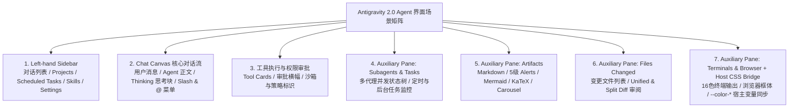

# 02 需求分析与产品规格说明书（PRD）

> **简体中文** | [English](../en/02-prd-requirements.md) | [返回文档索引](../README.md)

| 元信息 | 内容 |
| :--- | :--- |
| **关联立项书** | [01 项目立项书](./01-project-charter.md) |
| **目标软件** | Antigravity 2.0 Agent 桌面端应用（不含代码编辑器） |
| **目标版本** | `v1.0.0`（含后续变体扩展预留） |
| **需求基线状态** | Draft — 待评审确认 |

---

## 1. 目标用户画像（Personas）

| 画像 | 典型角色 | 日常环境与痛点 | 核心诉求 |
| :--- | :--- | :--- | :--- |
| **P1：多智能体编排工程师** | 长期在 Antigravity 2.0 中并发调度多个 Subagents、后台任务与自动化工作流 | 同时监控 Chat Canvas、Subagents、Background Tasks 与 Terminals；工具卡片与审批提示容易在信息流中淹没 | 清晰的运行态色彩语法（执行中 / 等待 / 需审批 / 成功 / 失败），一眼定位阻塞节点 |
| **P2：深度研究与文档评审者** | 高频阅读与批注 Agent 产出的长篇 Artifacts（架构分析、报告、Mermaid 图表、公式） | 连续阅读数千字 Markdown 与图表时，纯黑/纯白底色引起眼疲劳，5 级 Alert 与引用块视觉层次不清晰 | 出版级阅读舒适度，深浅双模式皆具备高级纸感/深空质感与清晰的排版层次 |
| **P3：代码审查与交付验收者** | 在 Antigravity 2.0 的 **Files Changed** 面板审阅 Agent 生成的大段改动与终端测试日志 | 高饱和红绿 Diff 导致视觉疲劳，终端 ANSI 色彩在浅色/深色下发糊 | 通透低饱和 Diff 叠层、清晰的行内代码块高亮与严格可读的 16 色终端 |
| **P4：视觉敏感 / 无障碍需求用户** | 轻度散光、对眩光敏感或需要强环境光下办公 | 常规暗色在亮光环境反光难读，常规浅色偏刺眼或对比不足 | 量化保障的 APCA / WCAG 对比度基线、色觉障碍友好与后续高对比变体架构 |

---

## 2. 核心使用场景（Antigravity 2.0 Agent 全界面拆解）

严格对齐 **Antigravity 2.0 Agent 桌面端** 的三大布局区与宿主协议，主题必须对以下 **7 大核心界面场景**建立完整视觉规格：

### 场景 1：Left-hand Sidebar（左侧导航与全局配置）
- **覆盖元素**：New Conversation 按钮、会话列表（Active / Hover / Unread 通知圆点）、Projects 工作区切换器、Scheduled Tasks（Cron / Timer 状态徽章）、Skills & Customizations 列表、Settings 弹窗（Model Selection、Tool Execution Policy、Sandbox、Appearance）。
- **视觉目标**：作为稳定沉底的导航容器（Elevation 0），清晰承托当前激活会话与未读/运行中状态指示，不抢夺中央 Chat Canvas 的视觉焦点。

### 场景 2：Chat Canvas（对话画布、思考流与输入交互）
- **覆盖元素**：用户消息气泡/块、Agent Markdown 回复、折叠/展开的 **Thinking 思考块**、`/` Slash Commands 浮层菜单、`@` Mentions 上下文选择器（文件/历史对话/终端/Rules/MCP 工具）、Media Uploads 附件预览卡片、底部多行输入框与发送/停止按钮。
- **视觉目标**：
  - **Thinking 块 vs 正式回复**：思考推理块采用略降明度的静音容器与细左边框，一眼区分于正式回答，展开阅读时仍满足辅助正文对比度下限；
  - `/` 与 `@` 悬浮选择菜单具备清晰浮层边界（Elevation 3）与明确键盘焦点高亮。

### 场景 3：工具执行卡片与权限审批流（Tool Calls & Permission Grants）
- **覆盖元素**：工具调用折叠卡片（读文件、跑命令、搜网页、调 MCP 工具）、四态状态标识（`Running` 进行中脉冲、`Done` 成功、`Error` 失败、`Awaiting Approval` 待用户审批）、Proceed / Reject / Allow Once 按钮组、Sandbox 隔离徽章。
- **视觉目标**：将 **待审批（Approval）** 与 **错误（Error）** 从常规成功的工具日志中瞬间凸显，避免用户在长执行链中遗漏关键确认操作。

### 场景 4：Auxiliary Pane — Subagents & Background Tasks（并发编排监控）
- **覆盖元素**：多子代理卡片列表（Role / Model / 状态：`working`、`waiting`、`stopped`、`killed`）、后台任务与定时调度器状态卡片、实时滚动日志流与停止/交互控件。
- **视觉目标**：使用统一语义色系表达并发状态（进行中=主强调蓝/青、等待休眠=中性静音灰、成功=语义绿、异常/中止=语义红/琥珀），长时间盯盘不产生视觉噪音。

### 场景 5：Auxiliary Pane — Artifacts（富文档、图表与公式）
- **覆盖元素**：标题层级（H1–H6）、正文与链接、5 级 GitHub Alerts（`[!NOTE]`、`[!TIP]`、`[!IMPORTANT]`、`[!WARNING]`、`[!CAUTION]`）、Mermaid 流程图/时序图/状态图节点与连线、KaTeX 数学公式、Carousel 幻灯片切换器、内嵌围栏代码块与表格。
- **视觉目标**：5 级 Alerts 各自拥有清晰的左侧强调条与低饱和底色；Mermaid 图表与 KaTeX 渲染在 Dark 和 Light 模式下均无“黑字融于暗底”或“白底线条消失”问题。

### 场景 6：Auxiliary Pane — Files Changed（变更清单与 Diff 审阅）
- **覆盖元素**：变更文件列表（Added / Modified / Deleted / Renamed 徽章与 `+N / -M` 计数）、行级与字符级（Word-level）增删高亮、行号栏、折叠上下文分隔条。
- **视觉目标**：采用通透低饱和的语义绿/红叠层，让用户在 Agent 修改数十个文件后依然能够舒适、无残留地逐行审阅代码语义。

### 场景 7：Auxiliary Pane — Terminals & Browser Pane + 宿主 CSS 变量桥接
- **覆盖元素**：集成终端 16 色 ANSI 输出与命令装饰、Browser Pane 顶部地址栏/状态框体；以及向内嵌 HTML 视图 / MCP Apps 暴露的标准宿主 CSS 变量（`--color-background-*`、`--color-text-*`、`--color-border-*`、`--color-ring-*`、`--font-sans`）。
- **视觉目标**：主客户端与内嵌面板/终端浑然一体，16 色 ANSI 全部通过可读性门禁。

---

## 3. 主题变体矩阵（Variant Matrix）

| 变体名称（Display Name） | Theme Mode | 计划版本 | 目标场景 | 架构状态 |
| :--- | :--- | :---: | :--- | :--- |
| **Antigravity Dark** | `dark` | **v1.0.0** | 日常主力深色环境、低光/夜间多智能体长时间工作 | v1.0 核心交付 |
| **Antigravity Light** | `light` | **v1.0.0** | 日间明亮办公、Artifacts 长文深度阅读、会议共享/录屏演示 | v1.0 核心交付 |
| **Antigravity Dark High Contrast** | `hc-dark` | v1.1.0 | 无障碍高对比需求、弱视或强反光屏幕 | 架构预留（同套编译器参数化生成） |
| **Antigravity Light High Contrast** | `hc-light` | v1.1.0 | 极强环境光 / 投影演示 | 架构预留 |
| **Antigravity Dim (Soft Dark)** | `dark` | v1.2.0 | 极致护眼低对比偏爱群体 | 架构预留 |

---

## 4. 功能性需求（Functional Requirements）

| 编号 | 需求模块 | 详细描述 | 优先级 |
| :--- | :--- | :--- | :---: |
| **FR-01** | 标准化 Theme Pack 清单 | 输出符合 W3C DTCG 与 Antigravity Appearance 语义结构的 `theme.json`（含主题元信息、模式声明、三区表面 Token、语义状态 Token 与代码块色板）。 | P0 |
| **FR-02** | 宿主 CSS 变量完整映射 | 输出 `variables.css`，100% 映射 Antigravity 官方宿主 CSS 变量协议（`--color-background-{primary,secondary,tertiary,inverse,disabled,info,danger,success,warning}`、`--color-text-*`、`--color-border-*`、`--color-ring-*`）及扩展 Agent 组件变量（`--agy-*`）。 | P0 |
| **FR-03** | 三大布局区组件与毛玻璃材质 Token | 完整覆盖 Left-hand Sidebar、Chat Canvas（含 Thinking / Tool Cards / Approvals / `/` & `@` Menus）与 Auxiliary Pane 全部 6 类视图，并输出分层毛玻璃材质 Token（透明度、模糊半径、饱和度、高光描边及 `prefers-reduced-transparency` 不透明降级）。 | P0 |
| **FR-04** | Artifacts 富内容视觉规范 | 完整定义 Markdown 排版、5 级 Alerts、表格斑马纹/边框、Mermaid 图表调色变量、KaTeX 公式色与 Carousel 控件样式 Token。 | P0 |
| **FR-05** | 内嵌代码块与 Diff 高亮包 | 为 Chat Canvas 与 Artifacts 内的围栏代码块以及 Files Changed Diff 视图输出配套的语法高亮主题 JSON（Shiki 兼容格式），覆盖全部 Tier-1 主流语言。 | P0 |
| **FR-06** | 终端 ANSI 16 色调色板 | 为 Auxiliary Pane 集成终端输出完整的背景、前景、选区、光标及 16 个 ANSI 语义色槽。 | P0 |
| **FR-07** | 外观配置与官方适配指南 | 提供清晰的 `Settings > Appearance` 对应说明、配置文件模板与未来官方自定义主题导入适配器接口规范（零二进制侵入）。 | P1 |
| **FR-08** | 交互式视觉仿真预览台 | 构建静态 Web 仿真工作台，真实还原 Antigravity 2.0 三栏界面并支持一键切换 Dark/Light 预览与对比度检查。 | P1 |

---

## 5. 非功能性需求（Non-Functional Requirements）

| 编号 | 维度 | 量化要求 | 验证方式 |
| :--- | :--- | :--- | :--- |
| **NFR-01** | **零侵入与安全合规** | 纯静态数据资产（JSON + CSS），无任何客户端二进制补丁、Electron 注入或权限绕过代码。 | 代码审查 + 构建产物白名单校验 |
| **NFR-02** | **无障碍与对比度** | 核心正文/对话/Artifacts 文本满足 `APCA Lc >= 75`（最低硬下限 `>= 60`）且 `WCAG 2.1 >= 4.5:1`；辅助信息/Thinking 块满足 `APCA Lc >= 45` 且 `WCAG >= 3.0:1`；色盲友好。 | 自动化对比度单测（Vitest） |
| **NFR-03** | **目标软件聚焦** | 仅对齐 **Antigravity 2.0 Agent 桌面端**（macOS / Windows / Linux），不引入任何代码编辑器适配负担。 | 需求与 PR 评审门禁 |
| **NFR-04** | **确定性构建（Determinism）** | 相同源码在不同 OS / Node LTS 环境下编译出的 `dist/`（JSON + CSS）逐字节完全一致。 | CI Clean Build + `git diff --exit-code` |
| **NFR-05** | **变体可扩展性** | 新增主题变体只需新增 1 个 OKLCH 调色板模块并在注册中心登记，无需复制映射逻辑。 | 架构评审 + 多变体单测 |
| **NFR-06** | **国际化文档** | 所有核心项目文档与开源治理规范保持中英双语 1:1 平行维护。 | PR Review Checklist |

---

## 6. 对话与 Artifacts 内嵌代码块语言覆盖矩阵（Tier-1）

虽然本项目不是代码编辑器主题，但 Agent 的日常回复、Artifacts 报告与 Files Changed Diff 中高频出现各类代码片段。v1.0 对以下 **Tier-1 常见代码围栏语言** 提供精调高亮与 Shiki 快照回归验证：

| 类别 | Tier-1 代码围栏语言 | 重点校验特征 |
| :--- | :--- | :--- |
| **Web / 全栈** | TypeScript / JavaScript（含 JSX / TSX） | 类型注解、泛型、异步关键字、模板字符串、JSX 标签 |
| **AI / 数据 / 脚本** | Python | 装饰器、Type Hints、f-string、Docstring、async/await |
| **云原生 / 后端** | Go / Rust / Java | Struct/Trait/Interface、Lifetime/Macro、Annotation、错误处理 |
| **标记与样式** | HTML / CSS | 标签、属性、CSS 自定义属性（`--var`）、选择器与数值 |
| **配置与数据** | JSON / YAML / TOML | 键名与字符串色相分离、布尔/数值/Null、注释 |
| **文档与变更** | Markdown / Shell (Bash/Zsh) / Unified Diff | 标题/代码块嵌套、命令行变量与管道、Diff 增删块（`@@`/`+`/`-`） |

---

## 7. v1.0 验收标准（Definition of Done）

1. **双变体全量通过门禁**：`Antigravity Dark` 与 `Antigravity Light` 通过全部自动化校验（Schema、宿主 CSS 变量 100% 覆盖、APCA/WCAG 对比度矩阵、确定性构建）。
2. **仿真工作台视觉基线冻结**：Antigravity 2.0 三栏仿真预览台（含 7 大场景 + 全部 Tier-1 代码围栏）完成深/浅双模式快照冻结与人工视觉复核。
3. **实机美学与协议对齐验证**：对照真实 Antigravity 2.0 桌面端布局与 `--color-*` 宿主变量规范完成逐项核验，无文字不可读、浮层粘连、Alert/Mermaid 对比失衡问题。
4. **文档与合规就绪**：`LICENSE`（MIT）、双语 `README`、`CHANGELOG.md`、Theme Pack 说明与 GitHub Release / npm 产物齐备。

> **下一步关联阅读**：[03 视觉设计原则与色板评审体系](./03-visual-design-system.md)
