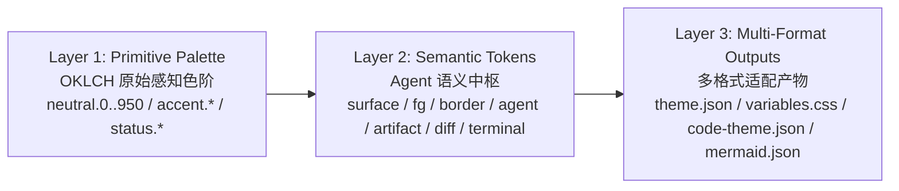

# 03 视觉设计原则与色板评审体系（Visual & Color Design System）

> **简体中文** | [English](../en/03-visual-design-system.md) | [返回文档索引](../README.md)

| 元信息 | 内容 |
| :--- | :--- |
| **关联需求文档** | [02 需求分析与产品规格说明书](./02-prd-requirements.md) |
| **目标软件** | Antigravity 2.0 Agent 桌面端应用 |
| **设计状态** | **已拍板定稿**：选定 **方案 A（Orbital Slate Dark + Orbital Cloud Light · 高不透明度哑光毛玻璃）**，详见 `ADR-006` |
| **色彩模型** | OKLCH（感知均匀色彩空间）→ sRGB Hex / CSS 变量编译输出 |
| **无障碍标准** | APCA（WCAG 3 草案感知对比度）+ WCAG 2.1（双门禁校验） |

---

## 1. 核心视觉哲学

Antigravity Theme 面向多智能体桌面工作台，围绕 **“失重三栏层次、静谧编排秩序、出版级阅读质感”** 三大核心原则展开：

1. **失重三栏层次（Weightless 3-Pane Depth）**：
   - 不依靠厚重阴影或高饱和粗边框切割界面，而是通过精准的明度微阶（Luminance Elevation）让 **左侧导航栏（Sidebar）、中央对话画布（Chat Canvas）、右侧辅助面板（Auxiliary Pane）与悬浮菜单（`/`、`@`、审批弹窗）** 自然悬浮分层。
   - 严禁纯黑（`#000000`）与纯白（`#FFFFFF`）大面积底色（高对比变体除外），避免长文阅读与夜间盯盘产生散光眩光（Halation）。
2. **静谧编排秩序（Calm Agent Orchestration）**：
   - 信息密度高时色彩更需克制：常规对话、已完成工具卡片与休眠子智能体保持低彩度中性秩序；仅将高辨识度语义色留给 **运行中（Running）、待审批（Needs Approval）、错误（Error）、重要 Alert 与 Diff 变更**。
   - 浅色模式绝非深色反转：独立收紧 Light 模式的 Chroma（彩度），确保长篇 Artifacts 阅读拥有接近高质感纸媒的温润清晰度。
3. **跨视图视觉一致性（Unified Host & Rich Media）**：
   - 主界面、Artifacts（Markdown / 5 级 Alerts / Mermaid / KaTeX）、Files Changed Diff、16 色终端以及宿主暴露的 `--color-*` CSS 变量全部派生自同一套 OKLCH 语义根，杜绝面板间色温打架。

---

## 2. 色彩科学与对比度基线（OKLCH + APCA + WCAG 2.1）

### 2.1 为什么采用 OKLCH 作为唯一设计空间

传统 HSL/HSV 在不同色相间存在严重感知亮度偏差。使用 **OKLCH（`L` 感知明度、`C` 彩度、`H` 色相角）** 具备三大工程优势：

- **等亮状态与图表色轮**：5 级 Artifact Alerts、工具状态徽章、Mermaid 节点色与内嵌代码块语法色共享统一 `L` 区间，视觉权重完全均衡。
- **可预测的深浅映射**：`Antigravity Dark` 与 `Antigravity Light` 复用同一套色相角骨架 `H`，仅系统化调整明度曲线 `L` 与彩度上限 `C`。
- **无失真色域映射**：超出 sRGB 色域的色值通过保持 `L`、`H` 不变、仅平滑回退 `C` 映射至 sRGB，防止对比度意外崩塌。

### 2.2 双模型对比度门禁基线

所有最终编译输出的 sRGB 实色与半透明叠加合成色，必须在构建期与 CI 中同时通过以下门槛：

| 视觉角色层级 | 典型 Antigravity 2.0 界面元素 | APCA 目标值（`|Lc|`） | APCA 硬下限 | WCAG 2.1 最低要求 |
| :--- | :--- | :---: | :---: | :---: |
| **L1 核心正文** | Chat 对话正文、Artifacts Markdown 正文、激活会话标题、设置项标签 | `>= 80`（浅色 `>= 85`） | `>= 75` | `>= 7.0:1`（推荐 AAA）/ 最低 `4.5:1` |
| **L2 交互与语义文本** | 链接、`/` 命令项、工具名、内嵌代码高亮、Mermaid 标签、KaTeX 公式 | `>= 70` | `>= 60` | `>= 4.5:1`（AA） |
| **L3 辅助与推理流** | **Thinking 思考块正文**、时间戳、折叠工具摘要、未激活侧边栏项 | `50 – 65` | `>= 45` | `>= 3.0:1` |
| **L4 状态与审批强调** | Running / Done / Needs Approval / Warning / Error 徽章、5 级 Alerts 标题 | `>= 65` | `>= 58` | `>= 4.5:1` |
| **L5 非文本边界与焦点** | 三栏细分割线、卡片边框、输入框聚焦环（`--color-ring-*`）、滚动条 | `>= 30`（聚焦环 `>= 45`） | `>= 20`（分割线）/ `>= 35`（聚焦环） | `>= 3.0:1`（聚焦环与核心图标） |

> **色觉障碍（CVD）约束**：
> - 所有工具执行状态、Subagent 状态、Files Changed Diff 与 5 级 Alerts 严禁仅靠红/绿区分，必须结合图标、文字标签与明度梯度协同传达。
> - 候选色板定稿前需通过 Deuteranopia、Protanopia、Tritanopia 模拟复核。

---

## 3. 三层 Design Token 架构

为支撑 `Dark` / `Light` 双变体与未来 `High Contrast` / `Soft Dim` 的零重复扩展，所有颜色严格分为三层：

### 3.1 Layer 1：Primitive Palette（原始色板）
- **中性阶梯（Neutral Ramp）**：12 级明度阶梯（`bg-deep` → `bg-canvas` → `bg-surface` → `bg-elevated` → `bg-overlay` → `border-subtle` → `border-strong` → `fg-muted` → `fg-secondary` → `fg-primary`）。
- **语义与图表色轮（Chromatic Set）**：8 个基础色相（Blue/Cyan/Violet/Green/Amber/Orange/Red/Magenta），每色含 `default`、`bright`、`tint`（低饱和卡片/Alert 底色用）三阶。

### 3.2 Layer 2：Semantic Tokens（Antigravity Agent 语义层）
- `surface.*`：`sidebar`、`canvas`、`auxPane`、`card`、`elevated`、`input`、`hover`、`selected`。
- `fg.*`：`primary`、`secondary`、`muted`、`disabled`、`inverse`、`accent`、`link`。
- `border.*`：`subtle`、`default`、`strong`、`focusRing`。
- `agent.*`：`userBubbleBg`、`thinkingBg`、`thinkingBorder`、`thinkingFg`、`toolCardBg`、`approvalBg`、`approvalBorder`、`runningAccent`、`subagentWorking`、`subagentWaiting`。
- `artifact.*`：`alertNote`、`alertTip`、`alertImportant`、`alertWarning`、`alertCaution`（每项含 `bg`/`border`/`fg`）、`blockquoteBorder`、`tableHeaderBg`、`codeBlockBg`、`mermaidNodeBg`、`mermaidEdge`。
- `diff.*`：`addedBg`、`addedWordBg`、`removedBg`、`removedWordBg`、`modifiedBadge`。
- `code.*`：内嵌代码块 12 项核心语法角色（Keyword / Function / Type / String / Number / Comment 等）。
- `terminal.ansi.*`：16 个标准 ANSI 终端色槽。

### 3.3 Layer 3：Platform Outputs（多格式编译产物）
- 由编译器将 Layer 2 统一输出为 `theme.json`、`variables.css`（含全部宿主 `--color-*` 变量）、`code-theme.json` 与 `mermaid.json`（详见 [04 技术架构与工程设计方案](./04-technical-architecture.md)）。

---

## 4. Antigravity 2.0 三栏表面层级与高不透明度哑光毛玻璃规范（Matte Glassmorphism）

本项目将 **“高不透明度哑光毛玻璃（High-Opacity Matte Frosted Glass）”** 定义为核心材质语言：区别于过度透底的炫技玻璃，采用 **高不透明度（84%–97%）+ 深度高斯模糊（`blur(24px–32px)`）+ `1px` 定向高光折射边（Specular Rim）**——仅在侧边栏与浮层保留柔和细腻的环境光漫透，同时让中央阅读区与 Artifacts 接近哑光丝绒质感，在任意桌面壁纸下确保零干扰、出版级护眼可读性。

### 4.1 四级高不透明度毛玻璃表面阶梯

| 层级 | 对应 Antigravity 2.0 区域 | Dark 玻璃参数（Alpha / Blur / Saturate） | Light 玻璃参数（Alpha / Blur / Saturate） | 材质描边与光影 |
| :--- | :--- | :--- | :--- | :--- |
| **Elevation 0（沉底哑光磨砂壳）** | Left-hand Sidebar、Auxiliary Pane 顶栏与底壳 | `L_canvas - 0.025`，`α = 0.84–0.88`，`blur(28px) saturate(130%)` | `L_canvas - 0.025`，`α = 0.86–0.90`，`blur(28px) saturate(135%)` | Dark：`1px rgba(255,255,255,0.08)`；Light：`1px rgba(255,255,255,0.70)` |
| **Elevation 1（主阅读丝绒玻璃画布）** | Chat Canvas 主背景、Artifacts 主文档区、Files Changed 视图 | 基准锚点 `L_canvas`，`α = 0.92–0.96`，`blur(24px) saturate(115%)`（近不透明，杜绝壁纸干扰长文） | 基准锚点 `L_canvas`，`α = 0.94–0.97`，`blur(24px) saturate(120%)` | 极细内分割线，保留微妙空间景深 |
| **Elevation 2（哑光磨砂卡片层）** | 用户消息块、Thinking 思考块、Tool Call 卡片、嵌入代码块、Subagent 卡片 | `L_canvas + 0.030`，`α = 0.78–0.86`（叠于画布上） | `L_canvas - 0.018`，`α = 0.84–0.90`（温润雾白卡片） | 顶部 `inset 0 1px 0` 微高光折射边 + 轻弥散阴影 |
| **Elevation 3（失重悬浮玻璃层）** | `/` Slash 菜单、`@` Mentions 弹窗、权限审批弹窗、底部浮空输入条 | `L_canvas + 0.055`，`α = 0.88–0.93`，`blur(32px) saturate(145%)` | 极净乳白哑光玻璃 `α = 0.90–0.95`，`blur(32px) saturate(145%)` | 清晰高光描边 + 多层柔和环境投影 |

### 4.2 毛玻璃无障碍与性能红线

1. **极端壁纸最坏情况对比度兜底**：得益于高不透明度设计，所有玻璃表面分别叠合于 **最亮极端背景（`#FFFFFF`）** 与 **最暗极端背景（`#000000`）** 时，核心正文均须严格满足 `APCA Lc >= 70`（常规默认壁纸 `>= 78`）。
2. **减弱透明度自动降级（Mandatory Fallback）**：`variables.css` 必须内置 `@media (prefers-reduced-transparency: reduce)` 规则块，自动将全部玻璃表面 `alpha` 提升至 `1.0` 并关闭 `backdrop-filter`，服务于视觉敏感用户与低功耗 GPU 设备。
3. **5 级 Artifacts Alerts 与 Diff 叠层**：Alerts 采用 `10%–14%` 通透叠色 + `3px` 实色左强调条；Files Changed 行级 Diff 透明度 `12%–18%`、字符级高亮 `28%–36%`，确保底层代码语法仍满足 `APCA Lc >= 55`。

---

## 5. 候选色板概念方向提案（供评审拍板）

以下提供 **3 套风格迥异但均严格满足上述 OKLCH / APCA 基线的候选方向**。Phase 1 编码前，将在 Antigravity 2.0 三栏仿真预览台中渲染同一组对话 + Thinking + Tool Cards + Artifacts + Diff 场景，按第 6 节打分卡拍板最终方案（记录于 `ADR-006`）。

### 候选方案 A：**Orbital Slate / Orbital Cloud（轨道静谧 · 极简失重哑光毛玻璃）—— ✅ 已选定（v1.0 基线）**
- **美学意象**：近地轨道的沉静深空灰蓝 + 高海拔云层纸白，强调耐看、护眼与极高现代秩序感（贴近 Linear / Raycast 级桌面应用质感）。
- **OKLCH 参数框架**：
  - **Dark 基座**：`L = 0.20–0.23`，`C = 0.014–0.018`，冷蓝灰底 `H ≈ 255°`；正文 `L = 0.88`。
  - **Light 基座**：`L = 0.975–0.985`，`C = 0.006–0.010`，微暖云白 `H ≈ 245°`；正文 `L = 0.26`。
  - **主强调色（Agent Active / Focus）**：失重钴蓝（`H ≈ 250°, C = 0.14`）辅以柔紫（`H ≈ 290°`）用于 Important / Subagent 标识。
  - **彩度上限**：Dark `C <= 0.135`，Light `C <= 0.145`。
- **优势**：长时阅读 Artifacts 与盯盘多智能体零疲劳，浅色模式极高级，Thinking / Tool 卡片层次克制优雅。
- **权衡**：视觉性格偏向冷静内敛，首眼冲击力低于高饱和科技风。

### 候选方案 B：**Nebula Pulse（星云脉冲 · 未来智能体科技风）**
- **美学意象**：深邃星际靛蓝底色 + 星云青（Cyan）与量子紫（Violet）双强调色，鲜明传递“多智能体 / 未来控制台”的高辨识度。
- **OKLCH 参数框架**：
  - **Dark 基座**：`L = 0.17–0.20`，`C = 0.022–0.028`，深靛黑 `H ≈ 265°`；正文 `L = 0.90`。
  - **Light 基座**：`L = 0.97–0.98`，`C = 0.010`，冷雾银白 `H ≈ 260°`；正文 `L = 0.24`。
  - **主强调色（Agent Active / Focus）**：星云青（`H ≈ 205°, C = 0.15`）+ 量子紫（`H ≈ 295°, C = 0.16`）。
  - **彩度上限**：Dark `C <= 0.165`，Light `C <= 0.160`。
- **优势**：运行中 Agent 脉冲、Mermaid 架构图与开源展示截图辨识度极强，记忆点突出。
- **权衡**：高彩度在连续阅读数千字长篇报告时需更谨慎控制局部面积，避免喧宾夺主。

### 候选方案 C：**Precision Lab（精密实验台 · 原生 Google / Material 秩序风）**
- **美学意象**：与 Google / Antigravity 原生现代设计语言高度融合——极简中性石墨灰与纯正出版纸白，仅用清晰的功能蓝与高无障碍语义色呈现关键状态。
- **OKLCH 参数框架**：
  - **Dark 基座**：`L = 0.21–0.24`，`C = 0.006–0.010`（近中性石墨灰 `H ≈ 255°`）；正文 `L = 0.90`。
  - **Light 基座**：`L = 0.985–0.99`，`C = 0.003–0.005`（纯正纸白）；正文 `L = 0.22`。
  - **主强调色（Agent Active / Focus）**：经典工程蓝（`H ≈ 255°, C = 0.15`），5 级 Alerts 与权限审批态极度清晰直觉。
  - **彩度上限**：Dark `C <= 0.130`，Light `C <= 0.140`。
- **优势**：与 Antigravity 2.0 原生界面过渡最无缝，文档/研究/工程全人群接受度最高。
- **权衡**：整体风格较为中性冷静，情感化氛围较弱。

---

## 6. 色板评审打分卡与决策流程

进入 Phase 1 前，在仿真预览台中基于同一套 Antigravity 2.0 场景样本（Sidebar + Chat + Thinking + Tool Approval + Subagents + Artifact 含 5 级 Alerts/Mermaid/Code + Files Changed Diff + Terminal）对比 A/B/C 三套方案，按以下权重打分（每项 1–5 分）：

| 评审维度 | 权重 | 评审关注点 | 方案 A | 方案 B | 方案 C |
| :--- | :---: | :--- | :---: | :---: | :---: |
| **1. 长文与多面板护眼度** | 25% | 三栏同屏 + 长篇 Artifacts 连续阅读是否零眩光、零压迫 | 待评 | 待评 | 待评 |
| **2. Agent 状态层级清晰度** | 25% | Thinking、Running、Needs Approval、Error、Subagents 是否一眼分辨 | 待评 | 待评 | 待评 |
| **3. 浅色主题完成度** | 20% | `Antigravity Light` 是否具纸媒质感，无发灰或荧光刺眼 | 待评 | 待评 | 待评 |
| **4. 品牌辨识与社区吸引力** | 15% | 整体截图是否具备“Antigravity”独特气质与传播力 | 待评 | 待评 | 待评 |
| **5. 无障碍与图表/Diff 鲁棒性** | 15% | APCA 余量、5 级 Alerts、Mermaid、Diff 与 16 色终端均衡度 | 待评 | 待评 | 待评 |
| **加权总分（满分 5.0）** | **100%** | — | **待评** | **待评** | **待评** |

> **评审结论归档（2026-11-21）**：经两轮高保真概念渲染对比与通透度校准，正式拍板采用 **方案 A（Orbital Slate Dark Matte Glass + Orbital Cloud Light Matte Glass）**，并已固化为 [04 技术架构与工程设计方案](./04-technical-architecture.md) 中的 **`ADR-006`**。方案 B（Nebula Pulse）留存作为后续扩展变体参考。

> **下一步关联阅读**：[04 技术架构与工程设计方案](./04-technical-architecture.md)
