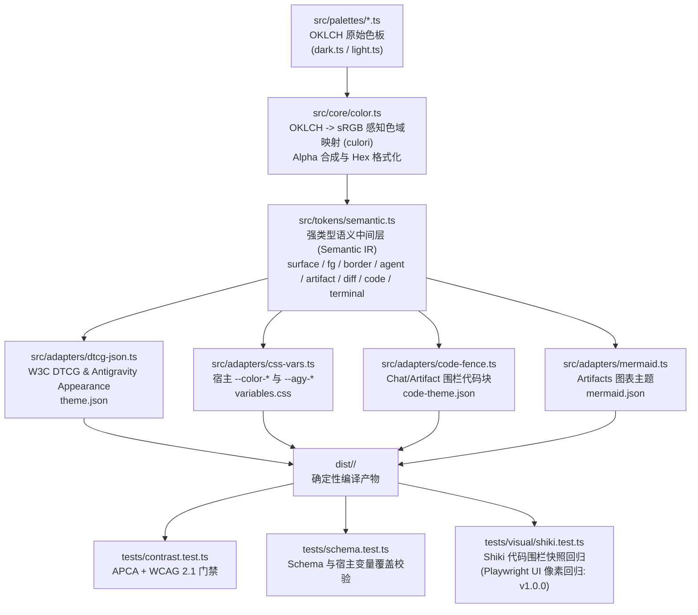

# 04 技术架构与工程设计方案（Technical Architecture）

> **简体中文** | [English](../en/04-technical-architecture.md) | [返回文档索引](../README.md)

| 元信息 | 内容 |
| :--- | :--- |
| **目标软件** | Antigravity 2.0 Agent 桌面端应用（非代码编辑器） |
| **技术栈核心** | TypeScript (ESM) + Node.js LTS (`>= 20`) + `pnpm` + `culori` + `apca-w3` + Vitest + Shiki（Playwright 视觉回归将于 `v1.0.0` 接入） |
| **核心产物** | 标准化 Antigravity Theme Pack（W3C DTCG `theme.json` + 宿主 `variables.css` + 内嵌 `code-theme.json` + `mermaid.json`） |
| **开源协议** | MIT License |

---

## 1. 总体系统架构（IR 中间层 + 多格式适配器）

为了兼顾 **当前 Antigravity 2.0 已知宿主 CSS 变量协议（`--color-*`）** 与 **未来官方自定义主题导入 Schema 演进**，系统采用 **“OKLCH 源码 → 强类型语义 IR → 多格式确定性适配器”** 架构：



---

## 2. 仓库目录结构（Phase 1–2 已实现架构）

```text
antigravity-theme/
├─ README.md                         # 英文主说明
├─ README.zh-CN.md                   # 中文主说明
├─ LICENSE                           # MIT License 全文
├─ CHANGELOG.md                      # Changesets 自动维护的变更日志
├─ CONTRIBUTING.md                   # 英文贡献指南（与 docs/07 互链）
├─ package.json                      # pnpm 脚本、npm 包清单 (@django9944/antigravity-theme) 与 exports 映射
├─ tsconfig.json                     # 严格模式 TypeScript 配置
├─ .upstream-baseline.json           # 上游 Antigravity 变更日志与宿主 CSS 变量基线快照
├─ .changeset/                       # Changesets 版本与发布元数据
├─ .github/
│  ├─ dependabot.yml                 # 每周自动检查 npm / GitHub Actions 依赖更新
│  ├─ workflows/
│  │  ├─ ci.yml                      # PR/Push 门禁：typecheck + build + test + dist 清洁检查 + 打包/离线巡检冒烟
│  │  ├─ release.yml                 # 自动发布：Changesets Version PR / GitHub Release (ZIP + SHA-256) + npm OIDC
│  │  └─ upstream-sync.yml           # 每周巡检 Antigravity App 更新日志与宿主 CSS 变量规范
│  ├─ ISSUE_TEMPLATE/                # Visual Bug、Variant RFC 模板及 config.yml
│  └─ pull_request_template.md       # PR 提交清单（含双语文档同步与仿真截图核验）
├─ docs/                             # 0-to-1 中英双语平行文档体系
│  ├─ README.md
│  ├─ zh-CN/                         # 01–07 中文文档
│  └─ en/                            # 01–07 英文文档
├─ src/                              # 编译器源码
│  ├─ core/
│  │  ├─ color.ts                    # OKLCH 构造校验、toGamut 感知色域映射、resolveShadow 与 blendOver
│  │  ├─ contrast.ts                 # APCA Lc (带符号极性) & WCAG 2.1 对比度计算封装
│  │  ├─ json.ts                     # 仅限 Plain Object 的稳定键排序与确定性 JSON 序列化
│  │  └─ types.ts                    # 强类型 Palette / SemanticIR / GlassShadowSpec / ThemePack 接口
│  ├─ palettes/
│  │  ├─ dark.ts                     # Antigravity Dark OKLCH 色板
│  │  └─ light.ts                    # Antigravity Light OKLCH 色板
│  ├─ tokens/
│  │  └─ semantic.ts                 # Primitive -> Agent Semantic IR 统一派生引擎
│  ├─ adapters/
│  │  ├─ dtcg-json.ts                # W3C DTCG + $extensions['com.antigravity-theme'] theme.json 生成器
│  │  ├─ css-vars.ts                 # 宿主 --color-*、--agy-*、--agy-glass-*、--agy-code-* 变量表生成器
│  │  ├─ code-fence.ts               # 内嵌代码块（Shiki 兼容）与 Diff 高亮生成器
│  │  └─ mermaid.ts                  # Artifacts Mermaid themeVariables 生成器
│  ├─ variants.ts                    # 变体注册中心（新增变体仅需在此注册）
│  └─ build.ts                       # CLI 确定性构建入口（.dist-staging 原子替换）
├─ dist/                             # 编译产物（提交至 Git，CI 强校验与源码逐字节一致）
│  ├─ manifest.json                  # 全局构建清单（版本、变体清单、模式与文件校验表）
│  ├─ antigravity-dark/
│  │  ├─ theme.json
│  │  ├─ variables.css
│  │  ├─ code-theme.json
│  │  └─ mermaid.json
│  └─ antigravity-light/
│     ├─ theme.json
│     ├─ variables.css
│     ├─ code-theme.json
│     └─ mermaid.json
├─ preview/                          # Antigravity 2.0 三栏交互仿真预览台（静态 Web，供视觉评审与回归）
├─ scripts/
│  ├─ check-upstream-app.ts          # 巡检 antigravity.google/docs/changelog.md (支持 --offline)
│  ├─ pack-release.ts                # 打包标准化 Theme Pack ZIP/tar.gz + SHA256SUMS.txt
│  └─ serve-preview.ts               # 本地安全预览服务器（Strict Path Allowlist + 405/403/400 防护）
└─ tests/
   ├─ fixtures/                      # 对话/Artifact 围栏代码样例（14 类语言/配置样本）
   ├─ contrast.test.ts               # 全量对比度矩阵单元测试（直接读取 dist/ 产物）
   ├─ schema.test.ts                 # DTCG Schema + 宿主 --color-* 100% 覆盖率 + 降级块校验
   ├─ scripts.test.ts                # 色彩异常防御、对比度极性翻转、上游解析与发布打包单元测试
   └─ visual/
      └─ shiki.test.ts               # Shiki 代码围栏 Token 与着色快照回归（Playwright 视觉回归计划于 v1.0.0）
```

---

## 3. TypeScript + OKLCH 编译器核心设计

### 3.1 强类型数据契约（`src/core/types.ts`）

源码调色板禁止裸写十六进制字符串，统一以 `OklchColor` 声明：

```ts
export interface OklchColor {
  readonly l: number;      // Perceptual lightness: 0.0 ~ 1.0
  readonly c: number;      // Chroma: 0.0 ~ 0.37
  readonly h: number;      // Hue angle in degrees: 0 ~ 360
  readonly alpha?: number; // Optional opacity: 0.0 ~ 1.0
}

export type ThemeMode = 'dark' | 'light' | 'hc-dark' | 'hc-light';

export interface VariantDefinition {
  readonly id: string;          // e.g. "antigravity-dark"
  readonly displayName: string; // e.g. "Antigravity Dark"
  readonly mode: ThemeMode;
  readonly palette: PrimitivePalette;
}
```

### 3.2 感知色域映射与 Alpha 合成（`src/core/color.ts`）
- **恒定 L/H 色域转换**：调用 `culori` 的 `toGamut('rgb', 'oklch', null, 0)`（关闭 JND 明度漂移容差），严格锁定 `L`、`H` 恒定，仅沿 `C` 二分收缩越界色度至 sRGB 边界，输出标准小写 `#rrggbb` / `rgba(...)`；`oklch()` / `withAlpha()` / `resolveShadow()` 均对有限数值与边界范围进行显式校验。
- **Alpha 叠加预计算**：内置 `blendOver(overlayRgba, backdropHex)`（严格拒绝半透明底色以防合成失真），用于计算 Thinking 卡片、5 级 Alerts 淡底、Diff 叠层与 Hover 态叠加后的有效实色，供 APCA / WCAG 测试直接校验。

### 3.3 确定性输出（`src/build.ts` & `src/core/json.ts`）
1. 通过 `sortKeysDeep()`（严格仅递归 Plain Object）对 JSON 键名按 ASCII 字典序稳定排序；CSS 变量按宿主 `--color-*`、组件 `--agy-*`、毛玻璃 `--agy-glass-*`、代码 `--agy-code-*` 等固定作用域分组，且每组内部按变量名字母序输出；
2. 采用 `[data-antigravity-theme="<id>"]` 选择器并配合 `@media (prefers-color-scheme: ...)` 包裹零特异度 `:where(:root:not([data-antigravity-theme]))` 默认回退；
3. 统一 UTF-8 无 BOM、POSIX LF、2 空格缩进、结尾单换行符，并通过 `.dist-staging` 原子替换写入 `dist/`；
4. 为每次构建产出 `dist/manifest.json`（含 SemVer 版本号校验、唯一变体 ID、主题模式与产物路径）。

---

## 4. Antigravity 2.0 宿主 CSS 变量桥接与外观适配规范

### 4.1 宿主标准 CSS 变量完整映射（`src/adapters/css-vars.ts`）

`variables.css` 100% 对齐 Antigravity 2.0 官方文档化宿主主题变量，确保客户端自身与内嵌 HTML 视图 / MCP Apps 视觉无缝统一：

| 宿主变量组 | 标准变量名 | 映射语义源（Layer 2） |
| :--- | :--- | :--- |
| **背景色（Background）** | `--color-background-primary`, `--color-background-secondary`, `--color-background-tertiary`, `--color-background-inverse`, `--color-background-disabled` | `surface.canvas`, `surface.shell`, `surface.card`, `fg.primary`, `surface.disabled` |
| **状态背景（Semantic BG）** | `--color-background-info`, `--color-background-danger`, `--color-background-success`, `--color-background-warning` | `status.info.bg`, `status.danger.bg`, `status.success.bg`, `status.warning.bg` |
| **文本色（Text）** | `--color-text-primary`, `--color-text-secondary`, `--color-text-tertiary`, `--color-text-inverse`, `--color-text-disabled`, `--color-text-info`, `--color-text-danger`, `--color-text-success`, `--color-text-warning` | `fg.primary`, `fg.secondary`, `fg.muted`, `fg.inverse`, `fg.disabled` 及对应状态色 |
| **边框色（Border）** | `--color-border-primary`, `--color-border-secondary`, `--color-border-inverse`, `--color-border-info`, `--color-border-danger`, `--color-border-success`, `--color-border-warning` | `border.default`, `border.subtle`, `border.inverse` 及对应状态边框 |
| **聚焦环（Ring）** | `--color-ring-primary`, `--color-ring-info`, `--color-ring-danger`, `--color-ring-success`, `--color-ring-warning` | `border.focusRing` 及对应状态焦点强调色 |
| **Agent 与代码扩展（`--agy-*`）** | `--agy-thinking-*`, `--agy-tool-*`, `--agy-approval-*`, `--agy-subagent-*`, `--agy-diff-*`, `--agy-code-*`, `--agy-mermaid-*`, `--agy-terminal-ansi-*` | 细粒度覆盖 Thinking、Tool Cards、Approvals、Subagents、Diff、围栏代码、Mermaid 图表与 16 色终端 |
| **毛玻璃材质变量（`--agy-glass-*`）** | `--agy-glass-bg-{shell,canvas,card,popover}`, `--agy-glass-blur-{sm,md,lg}`, `--agy-glass-saturate-{shell,canvas,popover}`, `--agy-glass-backdrop-{shell,canvas,popover}`, `--agy-glass-rim-top`, `--agy-glass-rim-border`, `--agy-glass-shadow-{card,popover}` | 控制四级毛玻璃透明度、模糊与饱和度复合滤镜、顶部及四向高光折射边，并配套 `@media (prefers-reduced-transparency: reduce)` 自动不透明降级与 `backdrop: none` |

### 4.2 安全合规的交付与未来官方导入对接

- **严格零侵入原则**：本仓库不提供任何 Electron `asar` 解包脚本、应用二进制补丁或绕过 macOS 代码签名的工具。
- **当前可用路径**：
  1. 作为 **Antigravity Appearance 标准化主题配置包**（W3C DTCG `theme.json` + `variables.css`），可用于 Antigravity 2.0 仿真工作台验证、MCP Apps / 自定义 HTML 面板主题同步以及向 Antigravity 官方提交社区主题提案；
  2. 一旦 Antigravity 2.0 在 `Settings > Appearance` 或 `~/.gemini/config/` 中开放正式第三方自定义主题 JSON/CSS 导入格式，仅需在 `src/adapters/` 新增一个轻量映射器即可无缝兼容。

---

## 5. 关键架构决策记录（ADRs）

### ADR-001：严格聚焦 Antigravity 2.0 Agent 桌面端，零侵入官方合规
- **状态**：Accepted
- **背景**：Antigravity 2.0 是独立 Electron 智能体应用，并非代码编辑器，目前无 `.vsix` 换肤商店。
- **决策**：仅面向 Antigravity 2.0 界面与宿主协议设计主题包；严禁采用客户端二进制注入或签名篡改等脆弱/不安全手段。
- **理由**：保障用户安全与客户端自动更新稳定性，所有资产长期可演进。

### ADR-002：采用 TypeScript + OKLCH（`culori`）构建编译器
- **状态**：Accepted
- **决策**：以 TypeScript 作为配置与编译语言，使用 `culori` 执行 OKLCH → sRGB 感知色域映射，使用 `apca-w3` 执行对比度校验。
- **理由**：静态类型保障 Token 引用零拼写错误；OKLCH 保证深浅双模式与 5 级状态色视觉明度均衡。

### ADR-003：采用“语义 IR + 多格式适配器”架构
- **状态**：Accepted
- **决策**：从同一套 `SemanticIR` 并行编译 `theme.json`（W3C DTCG）、`variables.css`（`--color-*` + `--agy-*`）、`code-theme.json` 与 `mermaid.json`。
- **理由**：当 Antigravity 2.0 发布新官方自定义主题格式时，只需增加 1 个 Adapter 文件，零成本复用全套色板、对比度门禁与测试资产。

### ADR-004：采用 MIT License 与 1:1 平行中英双语文档
- **状态**：Accepted
- **决策**：全仓库基于 **MIT License** 开源，`docs/zh-CN/` 与 `docs/en/` 严格平行维护。
- **理由**：最低法务摩擦，同时覆盖中文与全球英文社区。

### ADR-005：采用 Changesets + GitHub Releases & npm 自动发布
- **状态**：Accepted
- **决策**：通过 Changesets 管理版本号与 `CHANGELOG.md`，由 GitHub Actions 自动打包版本化 Theme Pack ZIP（附 SHA-256）发布至 GitHub Releases，并同步发布 `@django9944/antigravity-theme` 至 npm。
- **理由**：既方便桌面端用户直接下载标准化主题包，也方便 MCP Apps / 社区生态项目直接通过 npm 引用同一套 CSS 与 Token。

### ADR-006：v1.0 视觉方案选型——方案 A（Orbital Slate / Orbital Cloud 高不透明度哑光毛玻璃）
- **状态**：Accepted（2026-11-21 评审拍板）
- **背景**：在对比方案 A（Orbital Slate）、方案 B（Nebula Pulse）与方案 C（Precision Lab）及两轮毛玻璃通透度渲染后，需要敲定 v1.0 不可随意漂移的视觉基线。
- **决策**：正式选定 **方案 A** 作为 v1.0 双变体美学基线，并采用 **高不透明度哑光毛玻璃（High-Opacity Matte Frosted Glass）** 材质：
  - **`Antigravity Dark`（Orbital Slate Matte Glass）**：冷调深空蓝灰基座（`L = 0.20–0.23, C = 0.014–0.018, H ≈ 255°`），主强调色失重钴蓝（`H ≈ 250°, C = 0.14`）辅以柔紫（`H ≈ 290°`），Sidebar `α = 0.84–0.88` / 主阅读画布 `α = 0.92–0.96`。
  - **`Antigravity Light`（Orbital Cloud Matte Glass）**：微暖云雾瓷白基座（`L = 0.975–0.985, C = 0.006–0.010, H ≈ 245°`），深石墨蓝灰正文（`L = 0.26`），Sidebar `α = 0.86–0.90` / 主阅读画布 `α = 0.94–0.97`。
  - **无障碍兜底**：极端纯白/纯黑壁纸合成下核心正文 `APCA Lc >= 70`，并内置 `@media (prefers-reduced-transparency: reduce)` 全不透明降级。
- **理由**：在长篇 Artifacts 阅读、多智能体并发监控与日间/夜间全天候使用之间取得了最佳护眼平衡，且深浅两套变体气质高度统一；方案 B（Nebula Pulse）保留作为后续 v1.x/v2.x 社区扩展变体候选。

---

> **下一步关联阅读**：[05 质量保障与自动化测试方案](./05-qa-testing-plan.md)
