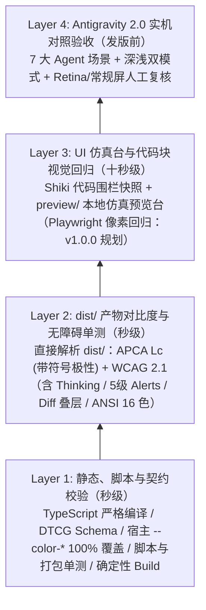

# 05 质量保障与自动化测试方案（QA, Accessibility & Visual Testing）

> **简体中文** | [English](../en/05-qa-testing-plan.md) | [返回文档索引](../README.md)

| 元信息 | 内容 |
| :--- | :--- |
| **关联技术方案** | [04 技术架构与工程设计方案](./04-technical-architecture.md) |
| **目标软件** | Antigravity 2.0 Agent 桌面端应用 |
| **测试框架** | Vitest + `apca-w3` + `culori` + 结构化 DTCG/CSS 解析断言 + Shiki（Playwright 视觉回归计划于 `v1.0.0` 接入） |
| **质量门禁原则** | 任何 CI 自动化测试失败均阻塞 PR 合并；Minor/Major 发版前必须完成实机视觉对照验收 |

---

## 1. 四层质量测试金字塔

Antigravity 2.0 作为高信息密度的多智能体桌面工作台，任何对比度退化、Alert 叠色过曝或审批态不清晰都会直接影响日常编排效率。本项目建立 **4 层质量保障体系**：

---

## 2. Layer 1：静态类型、Schema 与宿主协议覆盖校验（`tests/schema.test.ts`）

每次 PR 与 Push 自动执行以下断言：

| 校验项 | 规则与断言内容 | 失败判定 |
| :--- | :--- | :--- |
| **TypeScript 严格编译** | `tsc --noEmit` 零错误，禁止隐式 `any` 与未定义 Token 引用 | 任意编译错误 |
| **DTCG Schema 与 Manifest 校验** | 校验 `dist/<variant>/theme.json` 与 `dist/manifest.json` 严格符合 W3C DTCG 结构及 `package.json#exports` 一致性 | 缺少必填字段、键排序失序或导出失配 |
| **宿主 CSS 变量 100% 覆盖** | 分块解析 `dist/<variant>/variables.css`，断言全部 30 个 Antigravity 官方宿主色彩变量（`--color-background-*` / `--color-text-*` / `--color-border-*` / `--color-ring-*`）、`--font-sans`/`--font-mono`、18 个 `--agy-glass-*` 及全部 `--agy-*` / `--agy-code-*` 变量完整合法，且 `@media (prefers-reduced-transparency: reduce)` 降级全为实色 | 缺失任一宿主变量或存在无效/半透明降级色值 |
| **Mermaid & 代码块产物合法性** | 校验 `mermaid.json` 与 `code-theme.json` 完整包含所有必填角色且 Hex 格式统一小写 | 字段缺失或非法色值 |
| **零侵入与符号链接安全门禁** | 经由 `lstatSync` 校验 `dist/` 与发布包无符号链接、仅含白名单静态 JSON / CSS / 元数据，且在 `tests/scripts.test.ts` 中覆盖核心防御/打包/上游巡检逻辑 | 出现未授权文件类型、符号链接或脚本单测失败 |
| **确定性构建一致性** | 连续两次 `pnpm build` SHA-256 逐字节一致，且 CI 执行 `git status --porcelain dist/` 验证无未提交差异 | 源码已改但未重新编译提交 `dist/` |

---

## 3. Layer 2：自动化对比度与无障碍测试（`tests/contrast.test.ts`）

直接从已编译的 `dist/<variant>/` 产物读取真实输出，基于 [03 视觉设计原则与色板评审体系](./03-visual-design-system.md#22-双模型对比度门禁基线) 的双模型基线，对每个变体自动执行矩阵校验：

### 3.1 核心三栏与交互组件实色矩阵
- **Left-hand Sidebar**：`fg.primary` / `fg.secondary` / `fg.muted` vs `surface.shell`、`surface.selected`。
- **Chat Canvas**：用户消息文本 vs `agent.userBubbleBg`；Agent 正文与链接 vs `surface.canvas`；`/` Slash 与 `@` Mention 浮层项 vs `surface.elevated`。
- **Thinking 思考块**：`agent.thinkingFg` vs `agent.thinkingBg` 同时满足可读下限（`|Lc| >= 45`）且明确次于正式正文（与 `fg.primary` 保持足够层级差）。
- **Tool Calls & Permission Approvals**：Running / Done / Needs Approval / Error 四态标签与按钮在各自卡片底色上全部满足 `|Lc| >= 58`（`WCAG >= 4.5:1`）。

### 3.2 半透明毛玻璃与 Alpha 合成对比度校验
针对半透明玻璃层（Elevation 0–3）与叠层（5 级 Artifact Alerts 淡底、Files Changed 行级/字符级 Diff 叠色、悬停态 `surface.hover`）：
1. **极端壁纸双边界合成校验**：对所有高不透明度毛玻璃表面调用 `blendOver(glassRgba, '#ffffff')` 与 `blendOver(glassRgba, '#000000')`，断言两种极端壁纸下核心正文均满足 `|Lc| >= 70`（标准均衡壁纸下 `>= 78`）；
2. **减弱透明度降级校验**：校验 `@media (prefers-reduced-transparency: reduce)` 规则块存在于 `variables.css` 且全部不透明降级值通过标准对比度门禁；
3. 断言 5 级 Alerts 标题与正文在合成底色上满足 `|Lc| >= 60`（正文 `>= 75`），且 Files Changed Diff 叠层上全部内嵌代码语法色仍满足 `|Lc| >= 55`。

### 3.3 Terminal ANSI 16 色与图表对比校验
- 全部 16 个 `terminal.ansi*` 对终端背景色校验：除与背景同极性锚点外，其余 14 个功能色强制 `|Lc| >= 50`（主色彩色 `>= 60`）。
- 校验 `mermaid.json` 中的节点文字色 vs 节点背景色满足 `|Lc| >= 65`，连线色 vs 画布背景色满足 `|Lc| >= 30`。

---

## 4. Layer 3：Antigravity 三栏仿真工作台与 Shiki 视觉回归（`tests/visual/`）

### 4.1 Antigravity 2.0 仿真预览台（`preview/`）
由于 Antigravity 2.0 桌面端本身无法直接在无头 CI 容器中运行，本项目在 `preview/` 维护一套高保真静态 HTML/CSS 仿真工作台，直接挂载编译输出的 `dist/<variant>/variables.css`、`code-theme.json` 与 `mermaid.json`，集中展示：
- 左侧 Sidebar（Conversations / Projects / Scheduled Tasks / Skills / Settings Appearance）
- 中央 Chat Canvas（用户指令、Agent Markdown 回复、折叠/展开 Thinking 块、Running/Approval/Error 工具卡片、`/` 与 `@` 浮层）
- 右侧 Auxiliary Pane Tab 切换视图（Subagents 状态树、Background Tasks、Artifact 含 5 级 Alerts/Mermaid/KaTeX/Carousel、Files Changed Diff、16 色 Terminal）

### 4.2 双轨自动化回归
1. **Playwright 视觉截图回归**：在 CI 中对 `preview/` 的 Dark 与 Light 模式核心视口（Desktop 1440×900）执行自动化截图比对，超出像素容差自动生成 Diff 图并作为 CI Artifact 上传供 PR 审阅。
2. **Shiki 内嵌代码围栏快照回归（`tests/visual/shiki.test.ts`）**：读取编译产物 `dist/<variant>/code-theme.json`，对 `tests/fixtures/` 中的 14 类 Tier-1 样例（TS/TSX、Python、Go、Rust、Java、HTML/CSS、JSON/YAML/TOML、Markdown、Shell、Unified Diff）执行 `codeToTokens()` 快照校验，覆盖语法作用域着色的确定性稳定性（Playwright 自动化像素级截屏对比 `pnpm test:visual` 计划于 `v1.0.0` GA 接入；现阶段配合 `pnpm preview` 进行视觉评审）。

---

## 5. Layer 4：Antigravity 2.0 实机视觉对照验收清单（发版前强制执行）

每个 Minor / Major 版本发布前，维护者必须对照最新稳定版 **Antigravity 2.0 桌面端**完成以下人工验收（Dark & Light 各复核一遍）：

- [ ] **三栏明度层次**：确认 Left Sidebar、Chat Canvas、Auxiliary Pane 之间明度过渡柔和自然，无突兀黑块或刺眼纯白。
- [ ] **Thinking & Tool Cards**：确认折叠/展开 Thinking 块不抢主回复焦点；待审批（Needs Approval）与报错卡片在长对话流中一眼可锁定。
- [ ] **Subagents & Background Tasks**：确认 `working` / `waiting` / `stopped` / `killed` 四态视觉语义清晰，多卡片并列无杂乱感。
- [ ] **Artifacts 富内容**：逐一核验 H1–H6、5 级 Alerts（`NOTE` / `TIP` / `IMPORTANT` / `WARNING` / `CAUTION`）、Mermaid 流程图/时序图、KaTeX 公式与 Carousel 切换控件。
- [ ] **Files Changed Diff**：审阅 30+ 行多文件 Diff，确认红绿叠层柔和且代码语法清晰可读。
- [ ] **Terminals & Host CSS 变量**：核查 16 色终端输出清晰度，以及内嵌 HTML / MCP App 面板消费 `--color-*` 变量时的视觉一致性。
- [ ] **多屏幕清晰度**：在 macOS Retina 屏与常规 1x 屏幕下分别检查 `1px` 细边框、聚焦环与文字锐利度。

---

> **下一步关联阅读**：[06 发布、运维与上游同步手册](./06-release-maintenance-runbook.md)
