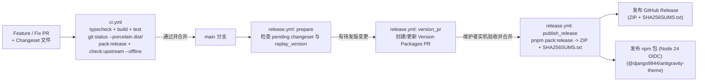
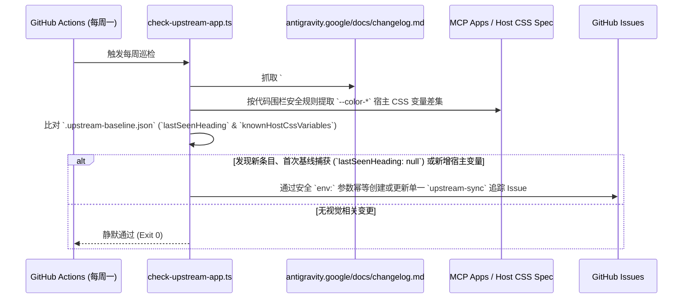

# 06 发布、运维与上游同步手册（Release, Maintenance & Upstream Sync Runbook）

> **简体中文** | [English](../en/06-release-maintenance-runbook.md) | [返回文档索引](../README.md)

| 元信息 | 内容 |
| :--- | :--- |
| **关联架构与测试** | [04 技术架构](./04-technical-architecture.md) · [05 质量保障方案](./05-qa-testing-plan.md) |
| **目标软件** | Antigravity 2.0 Agent 桌面端应用 |
| **CI/CD 平台** | GitHub Actions + Changesets |
| **发布渠道** | GitHub Releases（标准化 Theme Pack ZIP + SHA-256）+ npm (`@django9944/antigravity-theme`) |

---

## 1. 分支模型与 CI/CD 端到端流水线

采用极简高效的 **Trunk-Based Development（基于 `main` 主干开发）**，所有改动通过 Pull Request 经受自动化门禁验证：

### 1.1 `ci.yml` 强制门禁（PR & Push）
1. `pnpm install --frozen-lockfile`（禁用默认凭据持久化 `persist-credentials: false`）
2. `pnpm typecheck`（`tsc --noEmit`）
3. `pnpm build`（确定性编译 `dist/` 全部格式产物）
4. `test -z "$(git status --porcelain dist/)"`（确保已提交的编译产物包括未跟踪文件在内与源码逐字节同步）
5. `pnpm test`（Vitest 全量运行：DTCG Schema + 宿主 `--color-*` 100% 覆盖率 + APCA/WCAG 对比度 + 脚本与打包单测 + Shiki 代码块快照）
6. `pnpm check:upstream -- --offline` & `pnpm pack:release`（离线解析基线校验 + Theme Pack ZIP / `SHA256SUMS.txt` 打包冒烟校验）
7. *（`v1.0.0` GA 路线图）*：`pnpm test:visual`（Playwright 对 `preview/` 三栏仿真工作台执行 Dark/Light 像素级视觉回归比对）

---

## 2. 主题包语义化版本策略（SemVer Policy）

| 版本级别 | 示例 | 触发变更范围 | 是否需要迁移说明 |
| :--- | :--- | :--- | :---: |
| **Patch (`0.0.x`)** | `1.0.1` | 对比度微调（`ΔL <= 0.02`）、补齐 Antigravity App 新增局部状态 Token、单语言代码围栏高亮修复、Mermaid/Alert 细节修正、文档更正 | 否 |
| **Minor (`0.x.0`)** | `1.1.0` | 新增主题变体（High Contrast / Soft Dim）、新增输出格式适配器（如接入 Antigravity 2.0 未来官方自定义主题导入格式）、新增 Auxiliary Pane 视图完整适配 | 简短亮点说明 |
| **Major (`x.0.0`)** | `2.0.0` | 调整核心三栏基座底色或主强调色相、重命名或删除已有 `--agy-*` / `theme.json` 公共 Token 键、变更 Theme Pack 目录结构 | **必须**提供 Before/After 对比图与迁移指南 |

> **关键契约**：Antigravity 宿主标准变量名（`--color-background-*` / `--color-text-*` / `--color-border-*` / `--color-ring-*`）严格跟随官方文档规范，严禁擅自重命名。

---

## 3. 发布流程与凭据管理 SOP

### 3.1 首次发布前置配置
1. **GitHub Releases**：复用 GitHub Actions 内置最小权限 `GITHUB_TOKEN`（仅在 `release.yml` 授予 `contents: write` 权限）。
2. **npm Registry（`@django9944/antigravity-theme`）**：
   - 确认 npm Scope `@django9944`（与 GitHub 账号小写 Scope 一致）；
   - 在 **Node 24 + npm（`>= 11.5.1`）** 上配置 **npm Trusted Publishing（OIDC）**，无需配置静态 `NPM_TOKEN`（CI workflow 不传 `registry-url` 以免冲突）；
   - 通过 `package.json#publishConfig`（`access: "public"`, `provenance: true`）与 `pnpm ci:publish` 自动附带 Provenance 供应链溯源签名。

### 3.2 一次构建、双渠道同步（`release.yml` 三阶段流水线）
`release.yml` 拆分为 `prepare`、`version_pr` 与 `publish_release` 三个职责隔离的 Job：
1. `main` 推送存在 pending changesets 时，由 `prepare -> version_pr` 自动创建或更新 `Version Packages` PR；
2. 合并 `Version Packages` PR 后（无 pending changesets 且 tag 尚未发布），`prepare -> publish_release` 依次执行 `pnpm typecheck`、`pnpm build`、`pnpm test`、`pnpm check:upstream -- --offline` 与 `pnpm pack:release`，产出 `release/antigravity-theme-v${VERSION}.zip` 及 `release/SHA256SUMS.txt`；
3. 上传 ZIP 与 `SHA256SUMS.txt` 至 GitHub Release，并通过 Node 24 OIDC 执行 `pnpm ci:publish` 发布 `@django9944/antigravity-theme` 至 npm；
4. **幂等重跑机制**：若某一发布渠道因瞬时网络问题失败，可通过 `workflow_dispatch` 指定 `replay_version` 与 `target`（`both` | `github` | `npm`）仅重跑目标渠道，避免重复递增版本号。

### 3.3 凭据安全与保护环境
- 发布 Job（`publish_release`）绑定 GitHub Environment (`production-release`)，严格限制仅 `main` 分支触发，PR Fork 永远无法访问 OIDC 发布权限；
- 全链路使用 OIDC 短时效令牌（无长效 `NPM_TOKEN` 静态密钥留存）。

---

## 4. Antigravity App 上游更新日志与样式协议自动巡检

Antigravity 2.0 桌面端迭代频繁，新版本可能新增侧边栏入口、Auxiliary Pane 标签页、权限审批卡片样式或新的 `--color-*` 宿主 CSS 变量。

### 4.1 巡检脚本工作原理（`scripts/check-upstream-app.ts`）

> 注：初始 `.upstream-baseline.json` 中 `lastSeenHeading: null` 时，首次线上巡检将捕获当前最新条目并提示更新基线；CI 通过 `pnpm check:upstream -- --offline` 离线校验本地解析逻辑与基线格式（默认忽略围栏代码块内的 `--color-*` 示例）。

### 4.2 巡检响应 SLA
- **官方 Appearance 导入能力更新或新增 `--color-*` 宿主变量**：告警后 **7 天内**完成 Adapter 映射、对比度单测与 Patch/Minor 发布；
- **Antigravity App 新增面板或 UI 交互态**：同步更新 `preview/` 仿真工作台、补充语义 Token 与视觉回归快照；
- **上游已废弃样式键**：在 `dist/` 中保留至少 2 个 Minor 周期作为平滑过渡后再清理。

---

## 5. 维护更新周期与应急回滚预案（Incident Runbook）

### 5.1 日常维护节奏
- **每周**：审查 `upstream-sync.yml` 巡检报告与 Dependabot 自动依赖更新 PR（npm 依赖与 GitHub Actions 固定 SHA 版本）。
- **每月**：汇总社区已确认的对比度或面板细节 Issue，按需合并发布 Patch 版本。
- **每季度**：复核社区反馈与官方自定义主题支持进展、审查凭据安全、推进 Roadmap 新变体里程碑。

### 5.2 应急故障与回滚手册

| 故障场景 | 严重级别 | 应急处置步骤（SOP） |
| :--- | :---: | :--- |
| **场景 A：已发版本存在严重对比度破损或 CSS 变量缺失** | P0 | 1. 切出紧急分支 `hotfix/vX.Y.Z+1`；2. 修复问题并补齐防复发单测/快照；3. 添加 Patch Changeset 并合入触发**前向修复发版（Roll-Forward）**；4. 对旧版 npm 包执行 `npm deprecate` 标记提醒升级，并在 GitHub Release 标注说明。 |
| **场景 B：npm 或 GitHub Release 单边发布失败** | P1 | 1. 排查失败 Job 日志（OIDC 权限或短时 5xx）；2. 通过 `release.yml` 的 `workflow_dispatch` 传入 `replay_version` 与 `target`（`github` 或 `npm`）仅重跑失败渠道，复用同一版本构建产物。 |
| **场景 C：发布凭据疑似泄露** | P0 | 1. **立即**前往 npm 控制台吊销（Revoke）对应 Token；2. 审计近期 npm 包与 GitHub Release 的 SHA-256 校验和及 Provenance 签名；3. 切换至 OIDC Trusted Publishing 或生成新 Token，并记录复盘报告。 |

---

> **下一步关联阅读**：[07 开源治理、社区运营与路线图](./07-governance-roadmap.md)
