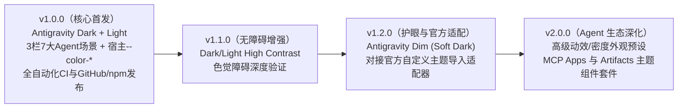

# 07 开源治理、社区运营与路线图（Governance, Contributing & Roadmap）

> **简体中文** | [English](../en/07-governance-roadmap.md) | [返回文档索引](../README.md)

| 元信息 | 内容 |
| :--- | :--- |
| **目标软件** | Antigravity 2.0 Agent 桌面端应用（不含代码编辑器） |
| **开源协议** | MIT License |
| **文档维护策略** | 中英双语平行同步（`docs/zh-CN/` 与 `docs/en/` 1:1 对应） |
| **社区沟通渠道** | GitHub Issues（缺陷与上游同步）· GitHub Discussions（美学讨论与 RFC） |

---

## 1. 开源治理模型与角色职责

本项目采用透明、务实的 **核心维护者共识制（Maintainer Consensus）**：

| 角色 | 职责范围 | 准入与权限 |
| :--- | :--- | :--- |
| **Project Lead（项目负责人）** | 把握视觉哲学与长期路线图、审定 Major 变更与最终发版 | 拥有仓库 Admin 与 `production-release` 审批权限 |
| **Core Maintainers（核心维护者）** | PR 评审、对比度与视觉回归把关、Antigravity App 上游巡检处置、社区 Issue 分诊 | 经连续高质量贡献后由 Project Lead 提名邀请，拥有合并权限 |
| **Contributors（社区贡献者）** | 提交对比度 Bug 修复、UI 仿真场景补充、新变体 RFC、代码块高亮优化与双语文档改进 | 任何遵守行为准则并通过 CI 的社区成员 |

---

## 2. 开源协议与合规要求（MIT）

1. **许可条款**：本项目全部源码、OKLCH Design Token、编译产物（`theme.json` / `variables.css` / `code-theme.json` / `mermaid.json`）、仿真预览台与文档均基于 **MIT License** 开源，允许自由使用、复制、修改、合并、发布、分发与商用，仅需保留原版权声明与许可声明。
2. **仓库必备文件**（Phase 1 初始化时落盘）：
   - 根目录放置标准 `LICENSE` 文件（含 `Copyright (c) 2026 Antigravity Theme Contributors`）；
   - `package.json` 明确声明 `"license": "MIT"`，确保 GitHub 与 npm 正确展示协议标识；
   - `scripts/pack-release.ts` 确保 `LICENSE` 文件随每个 Theme Pack ZIP 一起分发。
3. **贡献即授权（Inbound = Outbound）**：社区向本仓库提交的所有 Pull Request 默认遵循 MIT License 授权合入，无需额外签署繁琐的 CLA，最大化降低开源参与门槛。
4. **第三方依赖合规**：所有构建与测试依赖（`culori`、`apca-w3`、`shiki`、`vitest` 等，后续 `v1.0.0` 将补充 `playwright`）仅存在于 `devDependencies`（产物纯静态零运行时依赖），且均需采用 MIT / Apache-2.0 / BSD 等宽松兼容协议。

---

## 3. 社区贡献工作流与双语文档同步约定

### 3.1 标准 PR 提交流程
1. **先讨论后大改**：涉及新变体或调整核心基座色板的改动，先在 GitHub Discussions 发起轻量 RFC；局部对比度修复、面板细节优化或新增上游变量适配可直接提 PR。
2. **禁止直改产物**：所有配色改动必须修改 `src/` 下的 OKLCH 源码或适配器模块，运行 `pnpm build && pnpm test` 重新生成 `dist/` 与 Shiki 快照，并通过 `pnpm preview` 启动三栏仿真台目视核验，严禁手工编辑 `dist/` 产物（`pnpm test:visual` Playwright 自动化回归将于 `v1.0.0` 接入）。
3. **附带 Changeset**：面向用户的视觉/变量改动需执行 `pnpm changeset` 添加清晰变更摘要。
4. **视觉证据要求**：涉及颜色或面板层级的 PR 必须在描述中附带 `preview/` 仿真台 Before/After 对比截图。

### 3.2 双语文档同步规则
- 凡修改架构决策、需求规格、测试门禁或发布流程的 PR，应在同一 PR 内同步更新 `docs/zh-CN/` 与 `docs/en/` 对应章节；
- 若外部贡献者仅熟悉单一语言，允许先提交单语更新并自动打上 `docs-sync` 标签，由维护者在 7 天内补齐另一语言版本。

---

## 4. 视觉与组件 Bug 分诊 SOP（Issue Triage）

通过标准化 Issue 模板与分诊决策矩阵，精准区分客观缺陷、主观审美偏好与非目标软件请求：

### 4.1 强制复现信息（Issue Template 必填）
提交视觉或对比度 Bug 时，模板引导用户提供：
1. **主题变体**：`Antigravity Dark` 或 `Antigravity Light`；
2. **环境信息**：Antigravity 2.0 桌面端版本号、操作系统及显示器缩放比例；
3. **问题区域**：Left Sidebar / Chat Canvas / Thinking 块 / Tool Cards & Approvals / Subagents / Background Tasks / Artifacts（含 Alert/Mermaid/KaTeX）/ Files Changed Diff / Terminals；
4. **视觉截图与复现描述**：明确标注不可读元素或对比失衡区域。

### 4.2 分诊决策矩阵

| 类别 | 判定标准 | 处理方式与优先级 |
| :--- | :--- | :--- |
| **客观缺陷（P0 / P1）** | 违反 APCA/WCAG 对比度基线、Thinking/Tool/Approval 态混淆、5 级 Alert 或 Diff 不可读、遗漏 Antigravity 新增宿主 CSS 变量 | 标 `bug` + `confirmed`，纳入最近一次 Patch 修复并补齐单测/仿真台用例 |
| **生态场景增强（P2）** | 补全更多 Artifacts 图表类型、MCP App 面板样式细节或新增内嵌代码围栏语言 | 标 `enhancement`，欢迎社区 PR 并附带仿真样例 |
| **主观审美偏好** | 如“希望主强调色换成绿色 / 卡片圆角或底色更暖” | 友好引导用户通过 CSS 变量覆写（`variables.css` 局部覆盖）或在 Discussions 中沉淀社区定制片段 |
| **非目标软件或违规修改请求** | 要求适配代码编辑器（Antigravity IDE / VS Code / Cursor 等）或请求提供 Electron 二进制破解/注入补丁 | 标 `out-of-scope`，礼貌说明本项目仅面向 Antigravity 2.0 Agent 且坚持零侵入官方合规，关闭 Issue |

---

## 5. 新主题变体与新输出适配器准入标准

### 5.1 新增主题变体准入条件（如 High Contrast / Soft Dim）
1. 必须复用现有 Layer 2 Semantic IR 与 Layer 3 全部适配器：新增 `src/palettes/<variant>.ts` 并在 `src/variants.ts` 注册，同时同步在 `package.json#exports` 声明子路径导出，并在 `preview/`（`index.html` 与 `app.js`）补充主题切换选项；
2. 必须全量通过所属变体类型的 APCA / WCAG 对比度门禁（`hc-dark` / `hc-light` 采用高不透明度/实色表面并满足更严格的对比度阈值）；
3. 必须在 `preview/` 三栏仿真工作台（`pnpm preview`）中完成 7 大场景人工视觉复核（`v1.0.0` 后需同步补充 Playwright 像素基线），并明确长期维护承诺。

### 5.2 新增官方导出适配器准入条件
- 当 Antigravity 2.0 推出正式自定义主题导入格式（如新版 JSON Schema）时，在 `src/adapters/` 新增独立适配器模块，并配套 `tests/schema.test.ts` 校验规则，不得破坏既有 `theme.json` 与 `variables.css` 契约。

---

## 6. 长期演进路线图（Roadmap）

| 里程碑 | 计划重点 | 关键验收标志 |
| :--- | :--- | :--- |
| **v1.0.0** | 核心双变体（Dark / Light）、Antigravity 2.0 全界面 7 大场景、100% 宿主 `--color-*` 变量、对比度与三栏仿真回归 CI、GitHub Releases + npm 发布、App Changelog 上游巡检上线 | 完成全部 Phase 0–4 准出标准 |
| **v1.1.0** | 新增 `Antigravity Dark High Contrast` 与 `Antigravity Light High Contrast`（`hc-dark` / `hc-light`） | 满足 WCAG AAA、高对比边框与 CVD 深度核验 |
| **v1.2.0** | 新增低对比护眼变体 `Antigravity Dim`；第一时间适配 Antigravity 2.0 新增外观导入能力或新增 Auxiliary Pane 视图 | 社区 PR 贡献占比提升，官方格式零摩擦导入 |
| **v2.0.0** | 拓展排版密度/对话宽度与微动效外观预设；围绕 Antigravity 2.0 生态推出开箱即用的 Artifacts & MCP Apps 视觉主题组件包 | 形成完整的 Antigravity Agent 桌面端开源视觉设计体系 |

---

> **方案实施状态**：Antigravity Theme 0-to-1 全部 7 份核心规范文档已就绪；[`ADR-006`](./04-technical-architecture.md#adr-006选定方案-a更高不透明度哑光毛玻璃作为视觉基线) 已正式选定 **方案 A（`Antigravity Dark` + `Antigravity Light` 高不透明度哑光毛玻璃）** 并完成编译器、产物、测试与 CI 工程落地。返回 [文档总索引](../README.md) 或查阅 [03 视觉设计原则与色板方案](./03-visual-design-system.md)。
